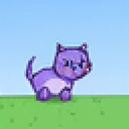

# 第 2 集 · 生图:训练学方向,生成走出来

《从零训一个多模态模型》第 2 集的代码、训练命令、训好的权重与样例。这一集从零训练一只只会「照字画图」的麻雀:输入「红色 小猫」,画出一张 64×64 的红色小猫。


## 1. 这一集讲了什么

上一集最后,同一团噪声一步步走成了红色小猫,可麻雀画的时候手里只有「红色」「小猫」两个词和一团噪声。这一集把「凭什么」拆成四块:**出题 → 学方向 → 一步步走 → 文字引导**。

训练时,把练习图压成的答案格子和一团噪声连一条直线,在线上随机取一点当题面;模型猜从噪声指向答案格子的方向,loss 量它猜得准不准。画的时候手里没有答案图:从起点噪声出发,每一步重新猜方向、顺着走一小步,默认走 30 步。每一步还猜两次,给题一次、不给题一次,把两者之差放大(引导强度,默认 3),画面就照着字走。这就是流匹配加无条件引导(CFG)。

一句话:**训练学方向,画时顺着方向走。**

## 2. 环境与硬件

- **显卡**:一块 NVIDIA 显卡。训练显存峰值约 5 GB(`weights/report.json` 的 `train_peak_mem_GB` 为 4.51),评测约 2.5 GB。原型在 8 GiB 显存上限下跑通;CUDA 自身上下文约 0.5 GB 不在这个上限里,所以 8 GB 的卡偏紧。
- **磁盘**:造出的图与动画约 2.8 GB,本集的编码缓存约 0.25 GB(6 万张图 × 32×8×8 × fp16)。
- **下载**:只要 FLUX.2 的图像 VAE(约 0.16 GB,Apache-2.0):
  ```bash
  hf download black-forest-labs/FLUX.2-klein-4B --include "vae/*"
  ```
- **软件**:我们用的是容器 `nvcr.io/nvidia/pytorch:25.09-py3`(PyTorch 2.9、numpy 2.1.0、Pillow 11.3.0),另装:
  ```bash
  pip install diffusers==0.40.0 transformers==5.17.0 accelerate==1.15.0 huggingface_hub==1.32.0 soundfile==0.13.1
  ```
  diffusers 要新到带 `AutoencoderKLFlux2` 的版本。

## 3. 照着跑

下面的命令都在 `code/` 目录里执行,`W` 是你选的工作目录。

```bash
cd code
W=../work            # 换成你自己的工作目录
mkdir -p $W/data $W/judges $W/runs

# ① 造数据:程序画的卡通小世界(纯 CPU,按核数并行)。测试集用另一段种子,和训练集一张都不重叠
#    用法:python data.py world <输出 npz> <图张数> <视频段数> <起始种子>(python data.py --help 也会打印这一行)
python data.py world $W/data/world_test.npz 2000 500 900000000
python data.py world $W/data/world_train.npz 60000 10000 0
#    产出 $W/data/world_test.npz、world_train.npz(图 64×64;顺带造出的动画本集用不上,但要留着,见下面判卷模型那步)

# ② 本集不用录音;encode.py 和 sparrow.py 都要读 voice.npz 里的录音标签,先放一份空的
python -c "import numpy as np; np.savez('$W/data/voice.npz', wav=np.zeros((0, 49920), np.float32), animal=np.zeros(0, np.int64), test=np.zeros(0, bool))"

# ③ 判卷模型:两个只用真图、真动画训的小 CNN,和麻雀无关(本集只用图的那个判卷;encode.py 启动时两个都会读,所以都要训)
python train_judges.py img --data $W/data --out $W/judges --steps 2000
python train_judges.py vid --data $W/data --out $W/judges --steps 1500
#    产出 $W/judges/judge_img.pt、judge_vid.pt 与同名 .json(测试准确率)

# ④ 编码:练习图过冻结的 FLUX.2 VAE,压成 32×8×8 的答案格子,存成缓存(本集只编 img)
python encode.py --data $W/data --judges $W/judges --out $W/cache --parts img
#    产出 $W/cache/labels.npz、img.npz、encode.json

# ⑤ 训练:从零训练 4000 轮,只练「文字→图」;每 250 轮停下来考一次(画对率随轮数的曲线)
python sparrow.py --data $W/data --cache $W/cache --judges $W/judges --out $W/runs/ep02 --tasks t2i --steps 4000 --eval_every 250
#    产出 $W/runs/ep02/final.pt(权重)、report.json(参数、loss 记录、终评)、samples/(6×8 网格与几张单图);
#    中途评测在 $W/runs/ep02/step250/ … step3750/(各有 report.json 与 samples/)。中途评测不影响训练本身的随机数

# ⑥ 画图:默认 30 步、引导强度 3
python infer.py $W/runs/ep02/final.pt t2i "红色 小猫" cat.png
#    也可以直接用本目录训好的权重:python infer.py ../weights/final.pt t2i "红色 小猫" cat.png
#    颜色:红色 橙色 黄色 绿色 蓝色 紫色 粉色 棕色;动物:小猫 小狗 小兔 小鸟 小鱼 小熊

# ⑦ 判卷:读 final.pt 重新评测 384 题(6 动物 × 8 颜色 × 8 张),只替换 report.json 的评测部分
python sparrow.py --data $W/data --cache $W/cache --judges $W/judges --out $W/runs/ep02 --tasks t2i --eval_only
#    终评在 report.json 的 eval.t2i(animal_acc、color_acc、both_acc)
```

说明:

- 训练用「轮」,画图用「步」;代码里训练轮数的参数名是 `--steps`;`infer.py` 画图固定走 30 步、引导强度 3(`sparrow.py` 里 `generate` 的默认值)。
- **画对率**:生成的格子经 VAE 还原成图,交给判卷模型判动物和颜色,两样都对才算对。判卷模型在测试图上动物、颜色都是 100%。
- `infer.py` 从种子 0 那团噪声出发,同一句话每次画出同一张图。

## 4. 本集的对照实验

下面三组都是片里演示的实测。2-1 就是上面第 ⑤ 步自带的中途评测;2-2、2-3 用同一份权重只改画法,一条命令跑完:

```bash
python ep3_assets.py --ckpt $W/runs/ep02/final.pt --data $W/data --judges $W/judges --out $W/runs/ep02_assets
#    画对率在 $W/runs/ep02_assets/summary.json 的 sweep.steps.<步数>、sweep.cfg.<引导强度>
#    (both_mean / both_min / both_max:每档 240 题 × 评测噪声种子 0/1/2)
#    单张与网格在 sweep/;同一个脚本还会出一步步生成(steps/)、训练怎么出题(lesson/)、最近邻(nearest/)、VAE 往返(vae/)
```

`ep3_assets.py` 的文件名沿用原型时期的编号,内容就是本集的素材脚本。

| 组 | 改什么 | 实测结果 |
|---|---|---|
| 2-1 训练进度 | 训练中每 250 轮考一次(384 题) | 画对率 250 轮 46.4%(178/384)、500 轮 86.7%(333/384)、750 轮 98.2%(377/384)、1000 轮起 100.0%(384/384);颜色 500 轮起全对、动物 1000 轮起全对;到顶后 loss 仍从 0.45 降到 0.29 |
| 2-2 画图步数 | 同一权重、同一批噪声,步数 1 / 2 / 3 / 5 / 8 / 10 / 15 / 25 / 50 | 每档 240 题 × 3 个评测噪声种子,报均值(范围):1 步 31.3%(29.6%–32.9%)、2 步 67.5%(66.3%–68.3%)、3 步 94.3%(93.3%–95.4%)、5 步起各档都是 100% |
| 2-3 引导强度 | 同上,引导强度 0 / 0.5 / 1 / 2 / 3 / 5 / 7 / 10(`u + CFG × (v − u)`:0 = 不给题的方向,1 = 给题的方向) | 同上口径:0 档 2.1%(1.3%–2.9%,和 48 选 1 乱猜同档)、0.5 档 91.3%、1 / 2 / 3 / 5 / 7 / 10 档都是 100%;10 档图没坏,比 3 档红得更深 |

- 2-1 与 2-2、2-3 是两批测量(题数、评测噪声不同),不拿来互相比较。
- 2-2、2-3 的数就是用 `weights/final.pt` 测的;2-1 是同一条命令带 `--eval_every 250` 另跑一次记下的。换成你自己训的权重,1–3 步、引导强度 0–0.5 这几档会有小幅出入。

## 5. 权重与样例

`weights/`:

| 文件 | 是什么 | sha256 |
|---|---|---|
| `final.pt` | 片中用的那份权重:按第 ⑤ 步的配方从零训练 4000 轮(训练种子 0,滑动平均 EMA 0.999;训练时没带 `--eval_every`,中途评测不影响训练本身),约 16M 参数;内含模型参数、训练参数和答案格子的归一化统计量,`infer.py` 直接能用 | `c13f94c0a07afdfb85143380be9716b012026f74ce01f7fa2d8a4e3f87f55d29` |
| `report.json` | 这次训练的报告:训练参数、每 100 轮的 loss、终评 | 见 `MANIFEST.sha256` |

终评:384 题画对率 100.0%,动物、颜色各 100%;loss 第 0 轮 1.9978、第 1000 轮 0.4561、第 3900 轮 0.2918。同一条命令再从零训一次,loss 走势一致(第 1000 轮 0.4534、第 3900 轮 0.2921),终评同样 384/384。

`samples/`(都是 256×256,由 64×64 放大):

- 6×8 网格就是这份权重终评时写出的 `samples/gen_t2i_grid.png`;只改步数、只改引导强度的单图也都出自这份权重。
- 单图的起点噪声是终评第 0 题那团:`sparrow.py` 评测时先 `torch.manual_seed(1234)`,第一批起点噪声里的第 0 个。第 ⑦ 步 `--eval_only` 写出的 `samples/gen_t2i_0_红色小猫.png` 用的就是这团(换一块显卡,VAE 还原的像素可能差 1/255 左右)。
- `infer.py` 从 `start_noise` 种子 0 那团噪声出发,和上面不是同一团,所以画出来的是另一只红色小猫;`ep3_assets.py` 的单图也从种子 0 出发,和 `infer.py` 一致。
- 训练途中两张来自 2-1 那次训练(第 ⑤ 步原样命令,带 `--eval_every 250`),起点同样是终评第 0 题那团。

| 红色小猫,30 步,引导强度 3 | 6 动物 × 8 颜色 |
|---|---|
|  |  |

只改步数(同一团噪声,引导强度 3):

| 1 步 | 5 步 | 50 步 |
|---|---|---|
|  |  |  |

只改引导强度(同一团噪声,30 步):

| 0 | 3 | 10 |
|---|---|---|
|  |  |  |

训练途中同一团噪声画的红色小猫(2-1):

| 500 轮 | 1000 轮 |
|---|---|
|  |  |

## 6. 常见问题

- **缓存删了怎么办?** `$W/cache/` 可以随时删,重跑第 ④ 步重建:只编 img,原型实测约半分钟(另加载入 VAE 的时间)。训练和评测都要它。
- **`FileNotFoundError: .../voice.npz`**:漏了第 ② 步。本集不用录音,放一份空文件即可。
- **`FileNotFoundError: .../judge_vid.pt`**:`encode.py` 启动时会读两个判卷模型,第 ③ 步两条都要跑。
- **造数据很慢**:`data.py world` 单核约 9 毫秒一张图、0.15 秒一段动画,按 CPU 核数并行(最多 96 进程)。
- **显存不够**:训练每步一批 512 张,显存只跟批大小有关;8 GB 的卡偏紧。
- **只想看效果**:跳过训练,直接用 `weights/final.pt` 跑第 ⑥ 步,只需要 FLUX.2 VAE,不要数据和缓存。
