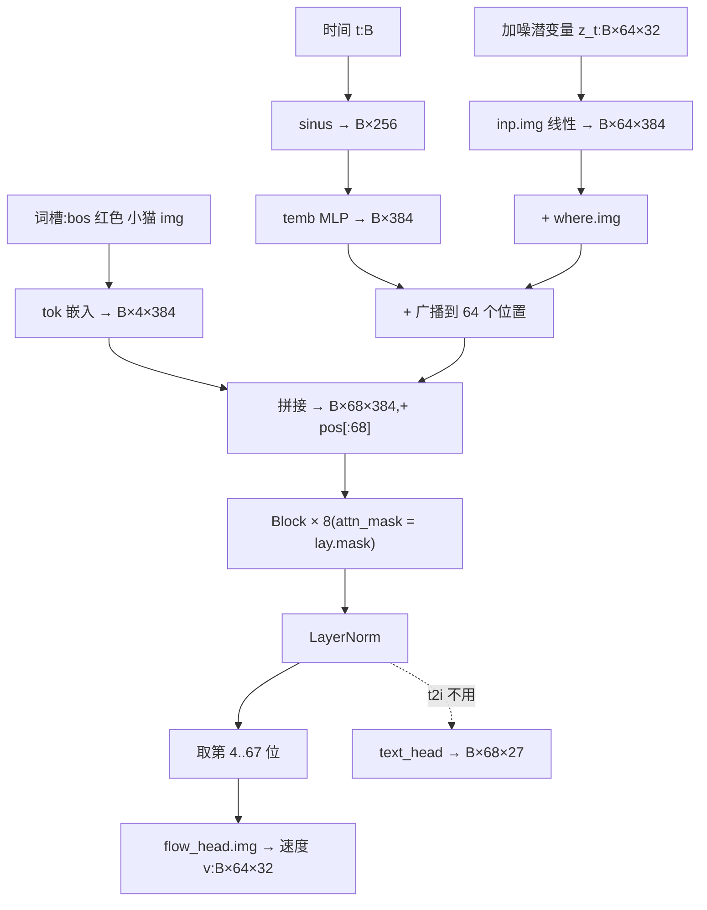

# 01 · 模型结构

本篇讲 `Sparrow` 这个 `nn.Module` 本身:它接收哪几种向量、每个子模块是干什么的、一次前向怎么走、16.04M 参数花在哪。序列怎么排、谁能看见谁,放在 [02-序列与注意力掩码](02-序列与注意力掩码.md)。

## 1. 六种向量:`MODS`

[sparrow.py:41-43](../code/sparrow.py#L41)

```python
# 模态:(每个向量几维, 每帧几个向量, 几帧, 是生成用的潜变量吗)
MODS = {"img": (32, 64, 1, True), "vid": (16, 64, 5, True), "aud": (512, AUD_FRAMES, 1, True),
        "see": (768, 16, 1, False), "watch": (768, 4, 16, False), "hear": (384, AUD_FRAMES, 1, False)}
```

小麻雀不直接吃像素或波形,而是吃**冻结预训练零件**输出的向量(训练前已由 `encode.py` 缓存好)。这六种向量分两类:

| 名字 | 来源(frozen.py) | 原始形状 | 进主干的形状 `[n×f, d]` | 生成? | 用在哪些任务 |
|---|---|---|---|---|---|
| `img` | FLUX.2 VAE 编码器 | `[32, 8, 8]` | `[64, 32]` | ✅ | t2i、a2i(要画的图) |
| `vid` | Wan2.1 时空 VAE | `[16, 5, 8, 8]` | `[5×64=320, 16]` | ✅ | t2v |
| `aud` | Kyutai Mimi(不量化的连续潜变量) | `[26, 512]` | `[26×4=104, 128]` | ✅ | t2a |
| `see` | SigLIP2 视觉塔,池化成 4×4 | `[16, 768]` | `[16, 768]` | ❌ | i2t |
| `watch` | SigLIP2,每帧池化成 2×2,16 帧 | `[64, 768]` | `[16×4=64, 768]` | ❌ | v2t |
| `hear` | Whisper-tiny 编码器,每 4 帧平均 | `[26, 384]` | `[26, 384]` | ❌ | a2t、a2i(听到的录音) |

**「生成」和「理解」用不同的编码器**,这是和 Janus、BAGEL、Qwen-Omni 一样的做法([sparrow.py:6-7](../code/sparrow.py#L6)):

- **生成**要能还原回像素/声音,所以走 **VAE / 音频编解码器的潜空间**:这种潜变量保留了重建所需的细节,模型在这里学去噪,画完再交给冻结的解码器还原。
- **理解**只要语义、不需要还原,所以走 **SigLIP2 / Whisper 这类表征编码器**:它们的特征语义更强,模型只需在后面接个小投影层就能「看懂/听懂」。

> **注意**:`aud` 那一行的 `512` 只是初值。`main` 会调用 [`split_audio(4)`](../code/sparrow.py#L58) 把它改写成 `(128, 104, 1, True)`——每个 512 维的 Mimi 帧被切成 4 个 128 维向量进主干,让声音段的「每个位置的维度」不至于远大于主干宽度 384。这个改写是**全局副作用**,所以 `load()` 也必须先按 checkpoint 里的 `aud_split` 调一次,模型结构才对得上([sparrow.py:362](../code/sparrow.py#L362))。

## 2. `Sparrow.__init__`:子模块一览

[sparrow.py:133-153](../code/sparrow.py#L133)

```python
class Sparrow(nn.Module):
    def __init__(self, dim=384, depth=8, heads=6, maxlen=400):
        self.tok = nn.Embedding(len(VOCAB), dim)
        self.pos = nn.Embedding(maxlen, dim)                                   # 序列里第几个
        self.temb = nn.Sequential(nn.Linear(256, dim), nn.SiLU(), nn.Linear(dim, dim))
        self.inp = nn.ModuleDict({m: nn.Linear(d, dim) if g else
                                  nn.Sequential(nn.LayerNorm(d), nn.Linear(d, dim), nn.GELU(), nn.Linear(dim, dim))
                                  for m, (d, n, f, g) in MODS.items()})
        self.where = nn.ParameterDict({m: nn.Parameter(torch.randn(n, dim) * 0.02) for m, (d, n, f, g) in MODS.items()})
        self.when = nn.ParameterDict({m: nn.Parameter(torch.randn(f, dim) * 0.02) for m, (d, n, f, g) in MODS.items() if f > 1})
        self.blocks = nn.ModuleList(Block(dim, heads) for _ in range(depth))
        self.norm = nn.LayerNorm(dim)
        self.text_head = nn.Linear(dim, len(VOCAB))                            # 文字出口
        self.flow_head = nn.ModuleDict({m: nn.Linear(dim, d) for m, (d, n, f, g) in MODS.items() if g})   # 生成出口
        for h in self.flow_head.values():
            nn.init.zeros_(h.weight); nn.init.zeros_(h.bias)
```

逐个说:

| 子模块 | 作用 | 要点 |
|---|---|---|
| `tok` | 27 个词的嵌入 | 词表见 `parts.py`:8 颜色、6 动物、4 动作、9 个记号(`<bos> <eos> <null>  </img> <aud> </aud> <vid> </vid>`) |
| `pos` | **全局**位置嵌入,序列第几个 | 可学习的绝对位置,`maxlen=400`;最长的 t2v 序列是 325,装得下 |
| `temb` | 时间嵌入 MLP | 把正弦编码 `sinus(t)`(256 维)映射到 384 维,告诉模型「这段潜变量噪声有多重」 |
| `inp[mod]` | 每种向量进主干的入口 | **生成潜变量用一层线性**(32/16/128 → 384);**理解特征用 LLaVA 式两层投影**(LN → Linear → GELU → Linear) |
| `where[mod]` | **模态内**位置嵌入 | 每帧里第几个向量(比如 img 的 8×8 格子里第几格),形状 `[n, 384]` |
| `when[mod]` | **帧**位置嵌入 | 只有多帧的 `vid`(5 帧)和 `watch`(16 帧)才有,形状 `[f, 384]` |
| `blocks` | 8 层 Transformer | 见下一节 |
| `norm` | 最后一层 LayerNorm | 两个出口共用 |
| `text_head` | **文字出口**:384 → 27 | 理解任务预测答案词 |
| `flow_head[mod]` | **生成出口**:384 → 该模态维度 | 每种生成模态一个,输出流匹配的速度 `v` |

### 为什么 `flow_head` 要零初始化

零初始化使训练第 0 步模型对任何输入都输出 `v = 0`。流匹配的目标是 `x1 − ε`,而缓存里的 `x1` 已按逐维均值/标准差归一化(方差 ≈ 1),`ε` 是标准正态(方差 = 1),两者独立,所以

$$\mathbb{E}\,\|0 - (x_1-\varepsilon)\|^2 / D = \mathrm{Var}(x_1)+\mathrm{Var}(\varepsilon) \approx 2$$

`weights/report.json` 里第 0 轮的 t2i loss 正是 **1.9978**。这样起步的好处是:一开始输出既不会乱跳,梯度也只先流进出口层,训练更稳(DiT 等扩散模型的常见做法)。

### 时间编码 `sinus`

[sparrow.py:112-115](../code/sparrow.py#L112)

```python
def sinus(t, dim=256):
    f = torch.exp(-math.log(10000) * torch.arange(dim // 2, device=t.device) / (dim // 2))
    a = t[..., None].float() * 1000 * f
    return torch.cat([a.cos(), a.sin()], -1)
```

和 Transformer 原版位置编码同一公式:128 个频率 `f_i = 10000^{-i/128}`,对 `1000·t` 取 cos/sin 拼成 256 维。`t ∈ [0, 1]` 先乘 1000,是沿用 DDPM/DiT「时间步 0~1000」的尺度,让高频分量对 t 的细小变化也敏感。

## 3. `Block`:一层 Transformer

[sparrow.py:118-130](../code/sparrow.py#L118)

```python
def forward(self, x, mask):
    B, L, D = x.shape
    q, k, v = self.qkv(self.n1(x)).view(B, L, 3, self.heads, D // self.heads).permute(2, 0, 3, 1, 4)
    x = x + self.proj(F.scaled_dot_product_attention(q, k, v, attn_mask=mask).transpose(1, 2).reshape(B, L, D))
    return x + self.mlp(self.n2(x))
```

- **Pre-LN** 结构:先 LayerNorm 再进注意力/MLP,残差直连,深一点也好训。
- 6 个头,每头 64 维;`qkv`、`proj` 不带偏置,MLP 是 4 倍宽(384 → 1536 → 384)+ tanh 近似的 GELU。
- `attn_mask` 是 `[L, L]` 的**布尔**矩阵(`True` = 可以看),由 `Layout` 预先算好,对 batch 和所有头广播。**整个模型里决定「谁能看见谁」的只有这张掩码**,文字因果、模态段内双向都靠它(见 [02](02-序列与注意力掩码.md))。
- 没有 dropout、没有 BatchNorm,所以 `train()`/`eval()` 模式对结果没有影响。

## 4. 一次前向:`embed` + `forward`

### `embed`:把一段模态向量变成主干的输入

[sparrow.py:155-162](../code/sparrow.py#L155)

```python
def embed(self, mod, x, t):
    d, n, f, g = MODS[mod]
    h = self.inp[mod](x)
    pos = self.where[mod].repeat(f, 1)                                     # 帧内位置
    if f > 1:
        pos = pos + self.when[mod].repeat_interleave(n, 0)                 # 时间位置:第几帧
    h = h + pos
    return h + self.temb(sinus(t))[:, None] if g else h
```

以 `vid`(n=64、f=5)为例:`where` 是 `[64, 384]`,`.repeat(5, 1)` 变成 `[320, 384]`(5 帧共用同一套格子位置);`when` 是 `[5, 384]`,`.repeat_interleave(64, 0)` 变成 `[320, 384]`(前 64 个都是第 0 帧……)。两者相加,每个向量就同时知道「我在第几帧的第几格」。这要求缓存里的视频潜变量是**按帧排**的,`tokens()` 正是这么排的(见 [03](03-数据与缓存.md))。

时间嵌入 `temb(sinus(t))` 是 `[B, 384]`,`[:, None]` 后广播加到这一段**每个**向量上;只有生成潜变量(`g=True`)才加。

### `forward`:按序列结构拼起来、过主干、取两个出口

[sparrow.py:164-181](../code/sparrow.py#L164)

```python
def forward(self, lay, tok, segs, t):
    hs, k = [], 0
    for p in lay.pieces:
        if p[0] == "text":
            hs.append(self.tok(tok[:, p[1]:p[2]]))
        else:
            hs.append(self.embed(p[1], segs[k], t if p[4] else torch.ones_like(tok[:, 0], dtype=torch.float)))
            k += 1
    h = torch.cat(hs, 1) + self.pos.weight[:lay.L]
    for b in self.blocks:
        h = b(h, lay.mask)
    h = self.norm(h)
    v = None
    if hasattr(lay, "noisy"):
        m, s, e = lay.noisy
        v = self.flow_head[m](h[:, s:e])
    return self.text_head(h), v
```

1. `lay.pieces` 按模板顺序列出「文字段 / 模态段」(由 `Layout` 生成)。文字段查 `tok` 嵌入,模态段走 `embed`,`segs` 按出现顺序一一对应。
2. 拼成 `[B, L, 384]`,再加**全局**位置 `pos`。所以模态向量其实有两套位置:全局的 `pos`(序列第几个)+ 模态内的 `where/when`(格子/帧)。
3. 过 8 层 `Block`,最后 `norm`。
4. 只把**加噪那一段**(`lay.noisy` 记录的 `[s, e)`)送进对应的 `flow_head`,得到速度 `v`,形状和输入潜变量一样。
5. `text_head` 对**所有**位置都算 logits `[B, L, 27]`,由调用方挑答案位置用。

> **注意 · 不加噪的段传 `t=1`**:对 `p[4]=False`(不加噪)的段,传的是全 1 的 `t`。眼下所有不加噪的段都是理解特征(`g=False`),`embed` 根本不加时间嵌入,所以这个 1 实际被忽略。它的意义在于约定:在流匹配里 **t=1 就是「干净数据」**,如果将来模板里出现一段「干净的生成潜变量当条件」(比如图生图),它就会自然拿到「无噪声」的时间嵌入。

> **注意 · 生成任务也算了 `text_head`**:t2i 训练时 `text_head(h)` 的输出被丢弃(`_, v = model(...)`),不进 loss,所以 `text_head` 拿不到梯度;只是多了一点无用计算。

> **注意 · 文字段不加时间嵌入**:`temb` 只加在加噪段上,文字位置想知道噪声多大只能通过注意力去看模态段。不过在 t2i 里文字段在因果掩码下本来就看不到后面的图(见 02),这对生成无影响。

## 5. 参数量拆账:16.04M 花在哪

用 `dim=384, depth=8, heads=6`、词表 27、`aud_split=4` 逐项算(结果 16,042,187,与 `report.json` 的 `params_M: 16.04` 一致):

| 部分 | 参数量 | 占比 | t2i 训练时有梯度? |
|---|---:|---:|:---:|
| `blocks`(8 层 × 1,772,928) | 14,183,424 | 88.4% | ✅ |
| `inp`(6 个入口) | 1,254,528 | 7.8% | 仅 `img` 的 12,672 |
| ├ `see` / `watch`(LN+两层投影,各) | 444,672 | | ❌ |
| ├ `hear` | 296,448 | | ❌ |
| ├ `aud` / `img` / `vid` | 49,536 / 12,672 / 6,528 | | 仅 `img` |
| `temb` | 246,528 | 1.5% | ✅ |
| `pos`(400 × 384) | 153,600 | 1.0% | ✅(只用前 68 行) |
| `where` + `when` | 106,752 + 8,064 | 0.7% | 仅 `where.img` 24,576 |
| `flow_head`(img / vid / aud) | 12,320 / 6,160 / 49,280 | 0.4% | 仅 `img` |
| `text_head` | 10,395 | 0.1% | ❌ |
| `tok` | 10,368 | 0.1% | ✅ |
| `norm` | 768 | — | ✅ |

每层 `Block` 的 1,772,928 = 两个 LN 1,536 + `qkv` 442,368 + `proj` 147,456 + MLP 1,181,568。

> **注意 · 不管训什么任务,七种本事的零件都会建出来**:`Sparrow` 按 `MODS` 全量建模,不看 `--tasks`。本集只训 t2i,真正被更新的约 14.64M,其余约 1.40M(理解投影、声音/视频入口和出口、`text_head`)保持初始化不动——`zero_grad(set_to_none=True)` 让它们的 `grad` 一直是 `None`,AdamW 会直接跳过,连权重衰减都不作用。这样 `final.pt` 的结构在各集之间一致,下一集可以 `--init` 接着训(见 [04](04-训练方式.md))。

## 6. 模块结构图(以 t2i 为例)


