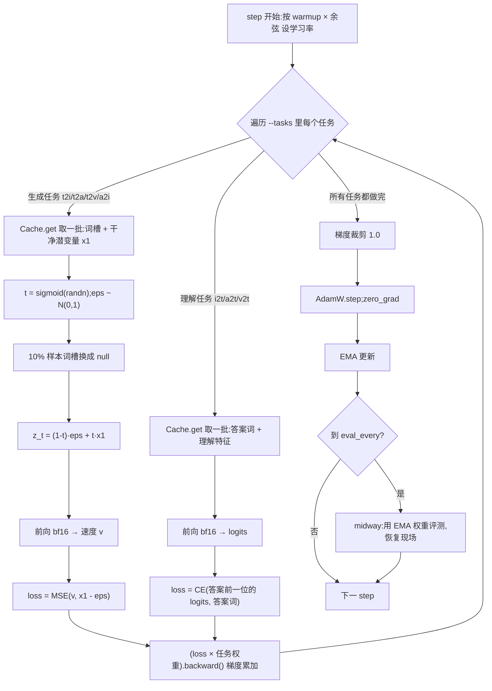

# 04 · 训练方式:流匹配 + 多任务

本篇讲 [`train`](../code/sparrow.py#L289) 和 [`midway`](../code/sparrow.py#L338)。先讲生成任务用的**流匹配**原理(本集的核心),再讲理解任务的交叉熵、多任务怎么拼在一起、优化器/学习率/EMA 等工程细节。

## 1. 一个训练 step 的全貌



## 2. 流匹配:训练学方向

[sparrow.py:302-311](../code/sparrow.py#L302)

```python
t = torch.sigmoid(torch.randn(B, device=dev))                  # logit-normal:中间的 t 多练
drop = (torch.rand(B, device=dev) < 0.1) if lay.slots else None  # 10% 去掉条件,供无条件引导用
tok = fill_tok(lay, slots, B, drop)
x1 = segs[-1]
eps = torch.randn_like(x1)
segs[-1] = (1 - t[:, None, None]) * eps + t[:, None, None] * x1
with torch.autocast("cuda", torch.bfloat16):
    _, v = model(lay, tok, segs, t)
loss = F.mse_loss(v.float(), x1 - eps)
```

### 出题:在噪声和答案之间连一条直线

- `x1`:一张训练图的潜变量(已归一化,`[B, 64, 32]`),就是「答案格子」。
- `eps`:同形状的标准正态噪声,就是「起点」。
- 在两者之间连一条直线,随机取一个时刻 `t ∈ (0, 1)`,线上那一点就是**题面**:

$$z_t = (1-t)\,\varepsilon + t\,x_1$$

  `t = 0` 是纯噪声,`t = 1` 是干净数据。

> **注意 · t 的方向**:这里是「t=0 噪声、t=1 数据」,和第 1 讲同一套([sparrow.py:5](../code/sparrow.py#L5))。SD3 / FLUX 的论文和代码常写成 `t=1` 是噪声,读别的资料时要先对齐方向。

### 答题:猜「从噪声指向答案」的方向

沿这条直线,位置对时间的导数是常数:

$$\frac{dz_t}{dt} = x_1 - \varepsilon$$

模型 $v_\theta(z_t, t, \text{文字})$ 的任务就是猜出这个**速度(方向)**,loss 是均方误差:

$$\mathcal{L} = \mathbb{E}_{t,\,\varepsilon,\,x_1}\big\|\,v_\theta(z_t, t, c) - (x_1 - \varepsilon)\,\big\|^2$$

为什么学方向就够了?MSE 的最优解是条件期望 $v^*(z, t, c) = \mathbb{E}[x_1 - \varepsilon \mid z_t = z, c]$——在 `z` 这个位置、这个时刻,所有可能经过这里的「噪声→答案」直线的**平均方向**。可以证明,沿这个平均速度场从纯噪声出发积分,终点的分布就是数据分布。所以画图时不需要答案:**从噪声出发,每一步问模型「往哪走」,走一小步,再问**(见 [05](05-生成理解与评测.md))。这就是 README 说的「训练学方向,画时顺着方向走」。

> **注意 · loss 不会降到 0**:同一个 `z_t` 可能来自很多不同的 (答案, 噪声) 组合,尤其 t 较小时 `z_t` 几乎全是噪声,模型只能给出平均方向,和每条具体直线必然有差距。所以 loss 的下限是这个条件方差,不是 0。本集 loss 从 1.9978 降到 0.2918 后还在缓慢下降,而画对率在 1000 轮就到了 100%(下文实测)。

### t 怎么采:logit-normal

`t = sigmoid(n), n ~ N(0, 1)`。t 不是均匀分布,而是集中在 0.5 附近:

| t 区间 | 概率 |
|---|---|
| 0.25 – 0.75 | ≈ 73% |
| < 0.1 或 > 0.9 | 各 ≈ 1.4% |

两端的题价值不大:t 接近 0 时几乎全是噪声,模型只能猜个平均方向;t 接近 1 时答案已经几乎写在题面上。真正决定画面「画的是什么、什么颜色」的是中间那段,所以多练中间。这是 SD3 论文实验得出的采样方式。

### 时间也作为输入

`model(lay, tok, segs, t)` 把 `t` 传进去,`embed` 里经 `sinus` + `temb` 加到每个图向量上(见 [01](01-模型结构.md))。同一个 `z_t`,不同的噪声程度下最优方向不同,模型必须知道 t。

### 10% 条件丢弃:为 CFG 准备「不给题」的答案

`drop` 让约 10% 的样本把 `C`、`A` 两个空位都换成 `<null>`。这些样本的 loss 一样是流匹配,但模型看不到题目,只能学「所有图的平均方向」。于是**同一个模型同时学会了有条件和无条件两种速度**,画图时两者一减就是「题目带来的方向」,再放大就是 CFG(见 [05](05-生成理解与评测.md))。

`if lay.slots else None`:只有带词槽的任务才丢。a2i 没有词槽(条件是录音),不做丢弃,生成时借用 t2i 的无条件分支(见 05 的注意点)。

## 3. 理解任务:答案词上的交叉熵

[sparrow.py:313-316](../code/sparrow.py#L313)

```python
tok = fill_tok(lay, slots, B)
with torch.autocast("cuda", torch.bfloat16):
    logits, _ = model(lay, tok, segs, None)
loss = F.cross_entropy(logits[:, lay.answer - 1].float().flatten(0, 1), tok[:, lay.answer].flatten())
```

- `fill_tok` 把**正确答案**填进序列(teacher forcing):预测动物时,前面的颜色位置放的是真颜色,而不是模型自己说的。
- `logits[:, lay.answer - 1]`:第 p 位的答案由第 p−1 位的输出预测(见 [02 的 i2t 掩码](02-序列与注意力掩码.md))。i2t 取 18、19、20 三个位置,得到 `[B, 3, 27]`,摊平后和 `[B·3]` 个真答案算交叉熵。
- 不加噪,`t` 传 `None`,理解特征段的时间嵌入不起作用(见 [01](01-模型结构.md))。

## 4. 多任务怎么拼:梯度累加、一次更新

[sparrow.py:298-322](../code/sparrow.py#L298)

```python
for task in a.tasks:
    lay, B = lays[task], a.bs_vid if task in ("t2v", "v2t") else a.bs
    ...
    (loss * a.weights.get(task, 1.0)).backward()
torch.nn.utils.clip_grad_norm_(model.parameters(), 1.0)
opt.step()
opt.zero_grad(set_to_none=True)
```

- **每个 step 每个任务各取一批**,依次前向、`backward()`;梯度在参数上累加,所有任务做完后**统一裁剪、统一更新一次**。效果等价于对「各任务 loss 的加权和」求梯度,但每个任务单独 backward,算完就释放计算图,显存峰值只取决于最大的那个任务。
- 不同任务序列长度不同(68 ~ 325),所以各自成批,不混在一个 batch 里。视频任务序列最长,批大小单独设成 `bs_vid=128`,其余 512。
- `--weights` 默认 `t2a=4`:念名字的 loss 乘 4,其它任务权重 1。本集只有 t2i,这个权重不起作用(但会记进 `report.json` 的 `args`)。
- **梯度裁剪**到全局范数 1.0,防止某一步某个任务梯度突然很大。

## 5. 优化器与学习率

[sparrow.py:290](../code/sparrow.py#L290)、[sparrow.py:294](../code/sparrow.py#L294)

```python
opt = torch.optim.AdamW(model.parameters(), lr=a.lr, weight_decay=0.01, betas=(0.9, 0.99))
...
lr = a.lr * min(1, (step + 1) / 300) * (0.1 + 0.9 * 0.5 * (1 + math.cos(math.pi * step / a.steps)))
```

- **AdamW**,`weight_decay=0.01`,`β2=0.99`(比默认 0.999 短,对小模型、短训练更灵敏)。所有参数一视同仁,没有给 LayerNorm/嵌入单独免衰减。
- 学习率 = 峰值 `6e-4` × **线性预热**(前 300 步从 0 涨到 1)× **余弦退火**(从 1 降到 0.1,不降到 0):

$$\text{lr}(s) = \text{lr}_{\max}\cdot\min\!\Big(1,\tfrac{s+1}{300}\Big)\cdot\Big(0.1 + 0.45\big(1+\cos\tfrac{\pi s}{S}\big)\Big)$$

本集 S = 4000 时的几个点:

| step | 0 | 299 | 1000 | 2000 | 3000 | 3999 |
|---|---|---|---|---|---|---|
| lr | 2.0e-6 | 5.9e-4 | 5.2e-4 | 3.3e-4 | 1.4e-4 | 6.0e-5 |

## 6. EMA:最终用的是滑动平均权重

[sparrow.py:291](../code/sparrow.py#L291)、[sparrow.py:323-325](../code/sparrow.py#L323)、[sparrow.py:332-334](../code/sparrow.py#L332)

```python
ema = [p.detach().clone() for p in model.parameters()]
...
d = min(a.ema, (1 + step) / (10 + step))
with torch.no_grad():
    torch._foreach_lerp_(ema, [p.detach() for p in model.parameters()], 1 - d)
...
for e, p in zip(ema, model.parameters()):
    p.copy_(e)
```

每步 `ema ← d·ema + (1−d)·当前权重`,用 `_foreach_lerp_` 对所有参数一次性做完。衰减率 `d` 不是一开始就是 0.999,而是 `(1+s)/(10+s)` 和 0.999 取小:

| step | 0 | 90 | 990 | 3999 |
|---|---|---|---|---|
| d | 0.100 | 0.910 | 0.991 | 0.998 |

一开始模型变化很快,d 小,EMA 紧跟当前权重,不会被随机初始化拖住;后面 d 变大,平均窗口变长(约 `1/(1−d)` 步)。训练结束把 EMA 拷回模型,**`final.pt` 存的是 EMA 权重**,评测和推理用的都是它。扩散/流匹配模型对 EMA 很敏感,平均后的权重画图明显更稳。

> **注意 · 本集 EMA 从没到达 0.999**:`(1+s)/(10+s) = 0.999` 要到 s ≈ 8990 才成立,本集只训 4000 轮,最后一步 d ≈ 0.9978,平均窗口约 450 步。`--ema 0.999` 在这里实际只是个上限。

## 7. 精度与日志

- 前向在 `torch.autocast("cuda", torch.bfloat16)` 里跑,参数和优化器状态是 fp32,loss 转回 float 计算。bf16 指数范围和 fp32 一样,不需要 `GradScaler`。`main` 里还打开了 TF32 矩阵乘([sparrow.py:568](../code/sparrow.py#L568))。
- 只有 `step % 100 == 0` 时才 `loss.item()`,避免每步一次 GPU 同步拖慢训练;日志记的是**那一步那一批**的 loss,有噪声。

## 8. 中途评测:`midway`

[sparrow.py:338-355](../code/sparrow.py#L338)

`--eval_every 250` 时,每 250 轮调用一次:

1. 保存 CUDA 和 CPU 的随机数状态;把当前「活」权重 clone 一份。
2. 把 EMA 权重拷进模型,调 `evaluate` 评测、导出样例,写 `O/step<N>/report.json`。
3. 把活权重拷回模型,恢复随机数状态。
4. 返回评测用时,`train` 把它加到 `t0` 上——**中途评测的时间不算训练时间**。

第 1、3 步的必要性:`evaluate` 一开头就 `torch.manual_seed(1234)`([sparrow.py:420](../code/sparrow.py#L420)),会重置全局随机数。不恢复的话,带不带 `--eval_every` 训出来的模型就不一样了。恢复之后,README 才能说「中途评测不影响训练本身的随机数」。优化器状态不受评测影响,所以不用存。

## 9. 本集实测

命令:`--tasks t2i --steps 4000`,其余默认(`bs=512, lr=6e-4, ema=0.999, dim=384, depth=8, heads=6`)。出自 `weights/report.json` 与 README 第 4 节。

| 指标 | 数值 |
|---|---|
| 参数量 | 16.04M |
| 训练用时 | 267.8 秒(4000 轮) |
| 训练显存峰值 | 4.51 GB |

loss(单批,每 100 轮记一次):

| step | 0 | 100 | 200 | 500 | 1000 | 2000 | 3000 | 3900 |
|---|---|---|---|---|---|---|---|---|
| t2i loss | 1.9978 | 1.372 | 0.877 | 0.5994 | 0.4561 | 0.3529 | 0.310 | 0.2918 |

第 0 轮 ≈ 2 正是 `flow_head` 零初始化的结果(见 [01](01-模型结构.md))。

对照实验 2-1(带 `--eval_every 250` 另跑一次,用当时的 EMA 权重考 384 题):

| 训练轮数 | 250 | 500 | 750 | ≥ 1000 |
|---|---|---|---|---|
| 画对率(动物、颜色都对) | 46.4% | 86.7% | 98.2% | 100.0% |

颜色 500 轮起全对,动物 1000 轮起全对——颜色是整片色块,比动物轮廓先学会。到顶之后 loss 还从 0.45 降到 0.29,说明后面的训练在提升细节质量,只是这个「判动物和颜色」的考卷已经测不出来了。

> **注意 · 结果可复现但不逐位相同**:`main` 固定了 `torch.manual_seed(0)`,但 GPU 上部分算子不是逐位确定的。README 里同一条命令再训一次,第 1000 轮 loss 是 0.4534(本份权重 0.4561),终评同样 384/384。

## 10. `--init`:课程式逐集续训

[sparrow.py:574-579](../code/sparrow.py#L574)

```python
if a.init:
    ck = torch.load(a.init, map_location=dev)
    bad = {k: (ck["args"][k], vars(a)[k]) for k in ("dim", "depth", "heads", "aud_split") if ck["args"][k] != vars(a)[k]}
    if bad:
        raise SystemExit(...)
    model.load_state_dict(ck["model"])
```

系列后面的集数会用 `--init 上一集/final.pt` 接着训,逐集加本事。只检查四个决定参数形状的超参;因为 `Sparrow` 总是按 `MODS` 全量建模(见 [01](01-模型结构.md)),本集没训的零件也在 checkpoint 里,形状能直接对上。续训时优化器状态、学习率预热和 EMA 都重新开始(EMA 从载入的权重起步)。

训练结束写出的 `final.pt` 内容([sparrow.py:588-589](../code/sparrow.py#L588)):

| 键 | 内容 |
|---|---|
| `model` | EMA 权重的 `state_dict` |
| `args` | 全部命令行参数(`load()` 据此重建模型和 `split_audio`) |
| `stat` | 用到的各模态的 `[mean, std]`,推理时 `denorm` 用 |
