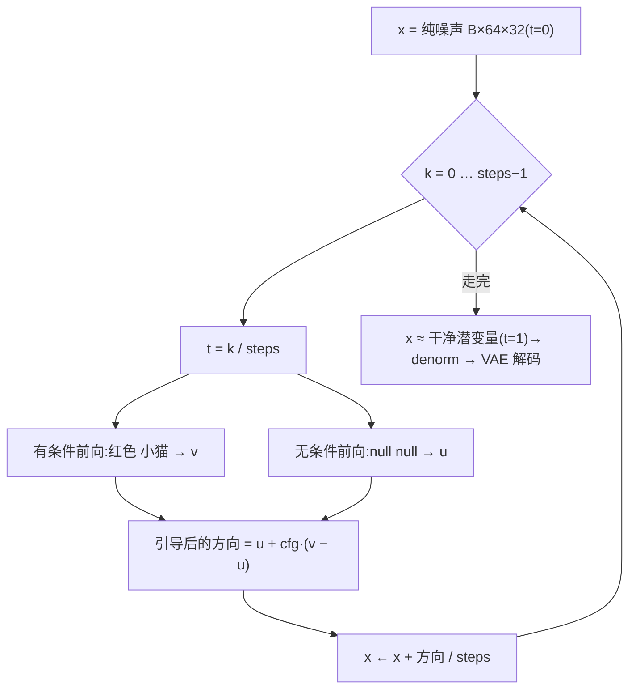
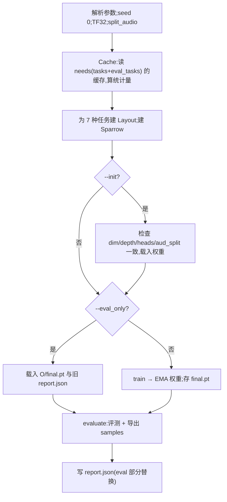

# 05 · 生成、理解与评测

训练学会了「方向」,本篇讲怎么用:生成任务从噪声一步步走出来(`generate`),理解任务逐词说出答案(`describe`),再由 `evaluate` 交给独立的判卷模型打分。最后是 `main` 的命令行参数。

## 1. 生成:`generate`

[sparrow.py:378-398](../code/sparrow.py#L378)

```python
@torch.no_grad()
def generate(model, lays, task, slots, B, cond=(), cfg=3.0, steps=30, x0=None, trace=None):
    lay = lays[task]
    ulay = lays["t2i"] if task == "a2i" else lay
    d, n, f, _ = MODS[lay.noisy[0]]
    x = torch.randn(B, n * f, d, device=dev) if x0 is None else x0.clone()
    if trace is not None:
        trace.append(x)
    tok = fill_tok(lay, slots, B)
    utok = fill_tok(ulay, {s: torch.full((B,), ID["<null>"], device=dev) for s in ulay.slots}, B)
    for k in range(steps):
        t = torch.full((B,), k / steps, device=dev)
        with torch.autocast("cuda", torch.bfloat16):
            v = model(lay, tok, list(cond) + [x], t)[1].float()
            u = model(ulay, utok, [x], t)[1].float()
        x = x + (u + cfg * (v - u)) / steps
        if trace is not None:
            trace.append(x)
    return x
```



### 欧拉法:顺着方向走

训练学的是速度场 $v(z, t) \approx dz/dt$。画图就是解这个常微分方程:从 `t=0` 的纯噪声出发,把 `[0, 1]` 等分成 `steps` 段,每段用当前位置的速度走一小步:

$$x_{k+1} = x_k + \frac{1}{\text{steps}}\, \hat v(x_k,\; t_k = k/\text{steps})$$

这是最简单的**欧拉法**。直线插值的流匹配,其速度场比较「直」,所以很少的步数就够(见下面 2-2 实测)。

> **注意 · 不在 t=1 处求速度**:循环里 t 取 `0, 1/30, …, 29/30`,最后一步从 29/30 走到 1,从不在 `t=1` 调用模型。这和训练对得上——`sigmoid(randn)` 采出的 t 严格在 (0, 1) 之间,两端几乎没练过。

### 无分类器引导(CFG)

每一步模型被调用**两次**:

- `v`:有条件,序列里是 `<bos> 红色 小猫 `;
- `u`:无条件,同模板,但词槽换成 `<null>`(训练时 10% 丢弃学来的,见 [04](04-训练方式.md))。

最终方向是

$$\hat v = u + \text{cfg}\cdot(v - u)$$

`v − u` 是「题目带来的那部分方向」。`cfg = 1` 就是只用有条件速度,`cfg = 0` 就是完全不看题,`cfg > 1` 是把题目的影响放大,画面更贴题、颜色更饱和(代价是多样性下降)。默认 `cfg = 3`、`steps = 30`,一共 60 次前向。

> **注意 · a2i 借用 t2i 的无条件分支**:`ulay = lays["t2i"] if task == "a2i" else lay`。a2i 的条件是一段录音,模板里没有词槽,训练时也就没做过条件丢弃,学不到自己的无条件速度。于是它借 t2i 的 `<bos> <null> <null>  [img]` 序列算 `u`——两者要画的都是 img 潜变量,「不给题时的平均图」是同一个东西。代价是:**a2i 的 CFG 依赖 t2i 被训练过**(包括 `<null>` 样本),单独只训 a2i 时无条件分支是没训过的。

> **注意 · 无条件分支不带 cond**:`u` 那次前向只传 `[x]`,不传 `cond`,所以对 a2i 来说录音完全不进入无条件分支,符合「不给题」的含义。

### 起点噪声与可复现

- `x0=None` 时用全局随机数 `torch.randn`;`evaluate` 开头 `torch.manual_seed(1234)`,所以终评每次起点相同。
- [`start_noise(lay, B, seed)`](../code/sparrow.py#L372) 用独立的 `torch.Generator` 按种子造起点,不受全局随机数影响。`infer.py` 和 `ep3_assets.py` 都用种子 0,所以「同一句话每次画出同一张图」。这和终评第 0 题不是同一团噪声,所以 `infer.py` 画出的红色小猫和 `samples/gen_t2i_0_红色小猫.png` 不一样(README 第 5 节)。
- `trace`:传一个列表进去,就把起点和每一步的 `x` 都存下来,`ep3_assets.py` 用它做「一步步生成」的动画。

### 实测:步数和引导强度(README 对照实验 2-2、2-3)

同一份 `weights/final.pt`、同一批噪声,每档 240 题 × 3 个评测噪声种子,报均值:

| 画图步数(cfg=3) | 1 | 2 | 3 | ≥ 5 |
|---|---|---|---|---|
| 画对率 | 31.3% | 67.5% | 94.3% | 100% |

| 引导强度(30 步) | 0 | 0.5 | 1 / 2 / 3 / 5 / 7 / 10 |
|---|---|---|---|
| 画对率 | 2.1% | 91.3% | 100% |

- **步数**:1 步就是沿起点处的速度一步跳到终点,得到的是「所有可能答案的平均」,画面发糊;3 步已到 94%,5 步起全对——印证了直线流匹配的速度场足够「直」。
- **cfg = 0**:只用无条件速度,画什么全凭噪声,2.1% 和 48 选 1 乱猜(≈ 2.08%)同档。这反过来说明:模型的「照字画图」能力**完全来自条件分支**,无条件分支确实学的是「不看题」。
- **cfg ≥ 1** 都 100%;cfg = 10 图没坏,只是比 3 档红得更深——`v − u` 被放大后颜色更饱和。

## 2. 理解:`describe`

[sparrow.py:401-410](../code/sparrow.py#L401)

```python
@torch.no_grad()
def describe(model, lays, task, segs, B):
    lay = lays[task]
    tok = fill_tok(lay, {s: torch.zeros(B, dtype=torch.long, device=dev) for s in lay.slots}, B)
    for p in lay.answer.tolist():
        with torch.autocast("cuda", torch.bfloat16):
            logits, _ = model(lay, tok, [s.float() for s in segs], None)
        tok[:, p] = logits[:, p - 1].argmax(-1)
    return tok[:, lay.answer]
```

逐个答案位置**贪心解码**:跑一次前向,取第 p−1 位 logits 的 argmax 填进第 p 位,再跑下一次。以 i2t 为例,三次前向依次说出颜色、动物、`<eos>`,返回 `[B, 3]`。

> **注意 · 空位先填 0 不会作弊**:词槽一开始填的是 id 0(恰好是「红色」)。但第 p 位的预测只读第 p−1 位的输出,因果掩码保证第 p−1 位看不见第 p 位及之后,所以这些占位值对当前预测没有影响;每说出一个词就覆盖掉对应的占位。

> **注意 · 没有 KV cache**:每说一个词都把整条序列重新算一遍。答案只有 2~4 个词、序列最长 71,这点重复计算可以忽略,换来代码最简单。

> **注意 · 不强制词类**:`argmax` 在全部 27 个词上取,没训好的模型可能在颜色位置说出 `</img>`。所以 `evaluate` 写文件名时用 `word()` 去掉斜杠([sparrow.py:435](../code/sparrow.py#L435))。

## 3. 加载:`load`(给 infer.py 用)

[sparrow.py:358-366](../code/sparrow.py#L358)

```python
def load(path):
    ck = torch.load(path, map_location=dev)
    a = ck["args"]
    split_audio(a["aud_split"])
    model = Sparrow(a["dim"], a["depth"], a["heads"]).to(dev)
    model.load_state_dict(ck["model"])
    lays = {t: Layout(t, a["vid_attn"] == "frame") for t in TASKS}
    return model.eval(), lays, {m: [x.to(dev) for x in st] for m, st in ck["stat"].items()}
```

只靠 `final.pt` 就能复原一切:按存下的 `args` 重建结构(先 `split_audio`,再建模型和全部 `Layout`),返回模型、各任务序列结构和归一化统计量。`infer.py` 的 t2i 流程:

```text
"红色 小猫" → 查 ID 得词槽 → generate(…, x0=start_noise(lay, 1, 0)) → denorm(stat, "img", x)
           → frozen.ImageVAE().decode → [1, 64, 64, 3] → 放大到 256×256 保存
```

> **注意 · 只能用训过的本事**:`stat` 只存了本次用到的模态。本集的 `final.pt` 只有 `img` 的统计量,用它跑 i2t 会因为没有 `see` 的统计量而失败——那几个零件的权重也是随机初始化的。

> **注意 · 设备写死为 cuda**:`sparrow.py` 第 40 行 `dev = "cuda"`,`autocast` 也写的 `"cuda"`。没有 NVIDIA 显卡的机器(包括 Apple Silicon)不改代码跑不起来。

## 4. 评测:`evaluate`

[sparrow.py:417-536](../code/sparrow.py#L417)

总体思路:**让模型做题,交给和它无关的判卷模型打分**。判卷模型是 `parts.py` 里的小 CNN(`ImageJudge`:4 个卷积块 → 动物 6 类 + 颜色 8 类两个头),由 `train_judges.py` 只用真图训练,在测试图上动物、颜色都是 100%。

开头三件事:`torch.manual_seed(1234)` 固定评测随机数;加载两个判卷模型;只为要评的任务加载对应的冻结解码器(本集只加载 FLUX.2 VAE)。

### t2i(本集唯一评测项)

[sparrow.py:452-472](../code/sparrow.py#L452)

```python
ai = torch.arange(6, device=dev).repeat_interleave(64)          # 动物:0×64, 1×64, …
ci = torch.arange(8, device=dev).repeat_interleave(8).repeat(6) # 颜色:每种动物里 0×8, 1×8, …
x = draw("t2i", {"C": ids(COLOR_ID, ci), "A": ids(ANIMAL_ID, ai)}, len(ai))
imgs = torch.cat([img_vae.decode(data.raw("img", x[s:e])) for s, e in chunks(len(x), 128)])
pa, pc = ij(to_float(imgs))
```

1. **出题**:6 动物 × 8 颜色 × 每组 8 张 = 384 题,第 `a·64 + c·8 + k` 题是「动物 a、颜色 c、第 k 张」。
2. **画**:`draw` 按 128 张一批调 `generate`(cfg 用 `--cfg`,30 步)。
3. **还原**:`data.raw` = `denorm`,再过 FLUX.2 VAE 解码成 64×64 图。
4. **判**:判卷 CNN 给出动物和颜色,`animal_acc`、`color_acc`、`both_acc`(两样都对)。
5. **样例**:`imgs.view(6, 8, 8, 64, 64, 3)[:, :, 0]` 取每组第 0 张拼成 6 行 × 8 列的 `gen_t2i_grid.png`;再挑 5 个(动物, 颜色)组合存单图。
6. **有没有背题**:算生成图到 6 万张训练图的最近邻像素 L2 距离,和「测试图到训练集」的最近邻距离对比。训练集留在内存里、8192 张一块搬上卡算 `cdist`。

本集终评(`weights/report.json`):

| 指标 | 值 |
|---|---|
| `animal_acc` / `color_acc` / `both_acc` | 1.0 / 1.0 / 1.0(384/384) |
| `nn_dist_gen_mean`(前 128 张生成图) | 2734.2 |
| `nn_dist_test_mean`(前 128 张测试图) | 2196.9 |
| 评测用时 / 显存峰值 | 15.9 秒 / 2.45 GB |

生成图离训练集的最近距离**比真实测试图还远**,说明模型没有把训练图原样背下来再吐出,而是画出了训练集里没有的新图。

### 其它任务的评测口径(本集不评,简表)

| 任务 | 题量 | 怎么判 | 指标 |
|---|---|---|---|
| t2a 念名字 | 6 动物 × 40 条 | 语音识别 Paraformer(`asr.py`)听写 | `sound_acc`(拼音对上,不计声调,主指标)、`exact_acc`(逐字对) |
| t2v 做动画 | 6 动物 × 4 动作 × 8 段,颜色轮换 | `VideoJudge`(逐帧 CNN + 时间卷积) | 动物 / 颜色 / 动作 / 三样全对 |
| i2t 看图 | 测试集 2000 张(种子与训练不重叠) | 直接比对标签 | 颜色 / 动物 / 都对 |
| a2t 听声 | 测试录音(没听过的 4 个音色) | 直接比对标签 | 动物 |
| v2t 看视频 | 测试集动画 | 直接比对标签 | 颜色 / 动物 / 动作 / 全对 |
| a2i 听→画 | 测试录音 | `ImageJudge` 判动物 | 动物(颜色不考,录音里没说颜色) |

> **注意 · 评测的上限是 VAE**:画对率衡量的是「小麻雀 + 冻结 VAE 解码 + 判卷」整条链。`encode.py` 会另外量 VAE「压了再还原」后的判卷准确率(写进 `encode.json`),那是这条链的天花板。

## 5. `main`:参数与流程

[sparrow.py:539-597](../code/sparrow.py#L539)

| 参数 | 默认 | 本集 | 说明 |
|---|---|---|---|
| `--tasks` | 全部 7 种 | `t2i` | 训练哪些本事 |
| `--eval_tasks` | 同 `--tasks` | — | 可以多评几样,量「学新本事时旧本事忘没忘」 |
| `--steps` | 24000 | 4000 | 训练轮数 |
| `--dim / --depth / --heads` | 384 / 8 / 6 | 同 | 主干宽度、层数、头数 |
| `--bs / --bs_vid` | 512 / 128 | 同 | 批大小(视频任务单独) |
| `--lr` | 6e-4 | 同 | 峰值学习率 |
| `--ema` | 0.999 | 同 | EMA 衰减上限 |
| `--cfg` | 3.0 | 同 | 评测时的引导强度 |
| `--aud_split` | 4 | 同 | Mimi 帧拆几段 |
| `--vid_attn` | full | 同 | `frame` = 视频每帧只看自己 |
| `--weights` | `t2a=4` | 同(不起作用) | 各任务 loss 权重 |
| `--eval_every` | 0 | 250(仅 2-1 那次) | 中途评测间隔 |
| `--init` | — | — | 从上一集 `final.pt` 接着训 |
| `--eval_only` | — | ⑦ 判卷时用 | 读 `O/final.pt` 重新评测 |

主流程:



> **注意 · `--eval_only` 仍要缓存**:它也会先建 `Cache`(要用测试集和归一化统计量),所以缓存删了要先重跑 `encode.py`。它载入旧的 `report.json`,只替换其中的 `eval`、`eval_seconds`、`eval_peak_mem_GB`,训练参数、耗时、loss 日志照旧。
