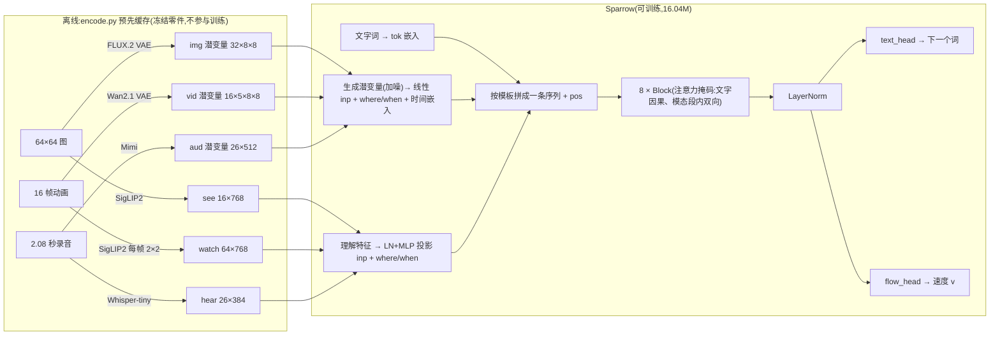

# sparrow.py 代码解析

[`code/sparrow.py`](../code/sparrow.py) 是整个系列的主模型「小麻雀」:一个约 **16.04M 参数**的小 Transformer,用**同一个主干**同时学会 7 种本事——文字→图、文字→声音、文字→视频、看图说话、听声说名字、看视频说话、听到名字画出来。第 2 集只训练其中的 **文字→图(t2i)**,所以这套文档以 t2i 为主线逐段展开,其余任务讲清机制、点到为止。

一句话概括它的架构(照 Transfusion / BAGEL 的路子缩小):

> **一条序列、一个主干、两个出口。** 文字词和各模态的向量排成一条序列,进同一个 8 层 Transformer;文字位置走「预测下一个词」的出口(交叉熵),被加噪的模态段走「流匹配速度」的出口(MSE)。

## 总览

## 阅读路线

| 篇 | 内容 | 适合先读的人 |
|---|---|---|
| [01-模型结构](01-模型结构.md) | `MODS` 六种向量、`Sparrow` 的每个子模块、`Block`、`forward`、参数量拆账 | 想知道「模型长什么样」 |
| [02-序列与注意力掩码](02-序列与注意力掩码.md) | `TEMPLATES` 七种序列、`Layout` 怎么造序列和掩码、t2i/i2t 掩码矩阵 | 想知道「多模态怎么塞进一条序列」 |
| [03-数据与缓存](03-数据与缓存.md) | 缓存格式、归一化、取一批数据、t2i 张量形状追踪表 | 想跟着张量走一遍 |
| [04-训练方式](04-训练方式.md) | 流匹配原理、logit-normal 采 t、条件丢弃、多任务循环、学习率、EMA、中途评测 | 想知道「怎么训」 |
| [05-生成理解与评测](05-生成理解与评测.md) | 欧拉采样 + CFG、贪心解码、评测口径、命令行参数 | 想知道「怎么画、怎么判」 |

不熟扩散模型的读者,建议按 01 → 02 → 04 → 05 的顺序读,03 当作随查的附录。

## sparrow.py 代码地图

| 行号 | 内容 | 详见 |
|---|---|---|
| [1–23](../code/sparrow.py#L1) | 文件说明:架构、七种序列、命令行用法 | 本页 |
| [41–55](../code/sparrow.py#L41) | `MODS`(六种向量规格)、`TASKS`、`GEN`、`TEMPLATES` | 01、02 |
| [58–65](../code/sparrow.py#L58) | `split_audio`、`needs` | 02 |
| [68–106](../code/sparrow.py#L68) | `Layout`:序列结构 + 注意力掩码 | 02 |
| [112–181](../code/sparrow.py#L112) | `sinus`、`Block`、`Sparrow` 主干 | 01 |
| [187–218](../code/sparrow.py#L187) | `tokens`/`untokens`、`FIELD`、`norm`/`denorm` | 03 |
| [221–283](../code/sparrow.py#L221) | `Cache`(读缓存、归一化、取一批)、`fill_tok` | 03 |
| [289–355](../code/sparrow.py#L289) | `train`、`midway` | 04 |
| [358–366](../code/sparrow.py#L358) | `load`(给 infer.py 用) | 05 |
| [372–410](../code/sparrow.py#L372) | `start_noise`、`generate`(采样 + CFG)、`describe`(贪心解码) | 05 |
| [417–536](../code/sparrow.py#L417) | `evaluate`:七种本事的评测与样例导出 | 05 |
| [539–597](../code/sparrow.py#L539) | `main`:命令行参数与主流程 | 05 |

## 周边文件(只简述接口)

| 文件 | sparrow.py 用到它的什么 |
|---|---|
| [`parts.py`](../code/parts.py) | 词表 `VOCAB`(8 颜色 + 6 动物 + 4 动作 + 9 个记号 = 27 词)、`ID`/`COLOR_ID`/`ANIMAL_ID`/`ACTION_ID`;判卷小 CNN `ImageJudge`/`VideoJudge`;`to_float`、`load_judge` |
| [`frozen.py`](../code/frozen.py) | 冻结的预训练零件:`ImageVAE`(FLUX.2)、`VideoVAE`(Wan2.1)、`Voice`(Mimi)、`See`(SigLIP2)、`Hear`(Whisper-tiny);评测时只用到解码器 |
| [`encode.py`](../code/encode.py) | 训练前把数据过冻结零件,写 `labels.npz` 与 `<零件>.npz` 缓存 |
| [`infer.py`](../code/infer.py) | 调 `sparrow.load` / `generate` / `describe` 做单条推理 |

## 本集的实测数字(出处)

文档里引用的数字都来自仓库里的两处:

- [`weights/report.json`](../weights/report.json):本集训练参数、每 100 轮 loss、终评(`params_M` 16.04、`seq_len`、`train_seconds` 267.8、`train_peak_mem_GB` 4.51、`eval.t2i`)。
- [`README.md`](../README.md) 第 4 节:对照实验 2-1(训练进度)、2-2(画图步数)、2-3(引导强度)。
