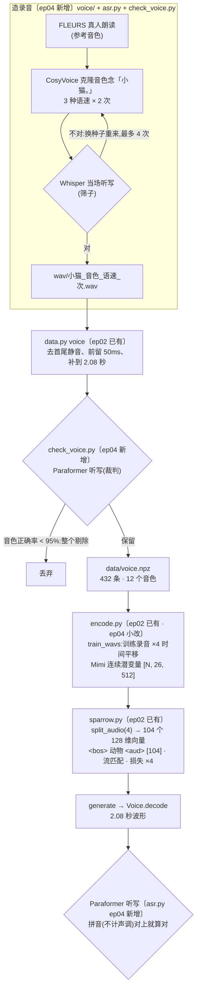

# 01 · 文字到声音:从造录音到念出名字

本篇沿着一条录音的一生走一遍:先合成出来,把关,剪成统一长度,压成 Mimi 潜变量,拆成向量进主干训练,再从噪声生成、解码回波形,最后交给 Paraformer 听写判对错。

每一节标题后面标了出处:

- **〔ep04 新增〕**:第 2 集没有,第 4 集新写的。
- **〔ep02 已有〕**:第 2 集的代码里就有,只是那一集没训练这一项。
- **〔ep02 已有 · ep04 小改〕**:第 2 集就有,第 4 集改了实现或接口。

## 0. 全链路一张图



## 1. 造录音:CosyVoice 念、Whisper 听〔ep04 新增〕

文件:[`voice/fetch.py`](../code/voice/fetch.py)、[`voice/speak.py`](../code/voice/speak.py)、[`voice/run.sh`](../code/voice/run.sh)。这一步在单独的 TTS 容器里跑,只用 CPU;训练时直接读仓库附带的 `data/voice.npz`,所以复现训练不需要跑这一步。

### 1.1 下载:`fetch.py`

| 下载什么 | 用途 | 许可 |
|---|---|---|
| FLEURS 普通话 train/dev/test(共 2.5 GB) | 真人朗读,作为零样本克隆的**参考音色** | CC-BY-4.0 |
| CosyVoice-300M-SFT | 自带「中文女」「中文男」两个内置说话人 | Apache-2.0 |
| Whisper-large-v3-turbo | 合成时当场听写把关 | MIT |

FLEURS 各份之间说话人不重叠,所以 **train/dev 里挑训练音色,test 里挑测试音色**。测试音色的人声,模型训练时一次都没听过。

### 1.2 挑音色:`speak.py pick`

[speak.py:41-80](../code/voice/speak.py#L41)。从 FLEURS 里筛参考音,条件如下:

- 时长 3~6 秒(`48000 <= 采样点数 <= 96000`,16 kHz);原文只含汉字和中文标点(`PLAIN` 正则)。夹着英文或数字的原文,克隆时容易把原文的尾巴也念出来。
- 男女各半。
- **去重**:用 CosyVoice 自带的说话人向量(CAM++)算余弦相似度,和已选的某个音色相似度超过 0.7 就跳过(同一个人通常在 0.8 以上),保证每个音色听得出差别。

结果写进 `voices.json`,外加两个 SFT 内置说话人 `sftF`、`sftM`(都归训练音色)。

### 1.3 合成:`speak.py say`

[speak.py:83-122](../code/voice/speak.py#L83)。每个「词 × 音色 × 语速(0.9/1.0/1.1)× 2 次」合成一条:

```python
for t in range(TRIES):                                   # 最多 4 次
    torch.manual_seed(zlib.crc32(key.encode()) + t)      # 每条、每次的种子固定,可断点续跑
    ...
    sec = len(librosa.effects.trim(wav, top_db=40)[0]) / m.sample_rate
    heard = asr([wav], m.sample_rate)[0] if sec <= MAX_SEC else ""   # 去静音后超过 1.95 秒的不听,直接算错
    tries.append({"sec": round(sec, 2), "heard": heard})
    if heard == word:
        break
```

- 收下的条件是**逐字**对上(`heard == word`),并且去静音后不超过 `MAX_SEC = 1.95` 秒。拖得太长,多半是念了多余的东西。
- 试满 4 次仍不对的,存成 `..._fail.wav`。它不进训练,但把关时按「没念对」计入该音色。
- 先写到 `.part.wav` 再 `os.replace`,中途被打断也不会留下半个文件。
- `run.sh say` 按分片起多个 Docker 容器并发合成。

### 1.4 两个识别器:`asr.py`

[asr.py](../code/asr.py)。这个文件第 2 集就**被引用了**(第 2 集 sparrow.py 的 evaluate 里有 `from asr import Paraformer`),但第 2 集目录里并没有它;第 4 集才正式附上。

| 类 | 模型 | 角色 |
|---|---|---|
| `Asr` | Whisper-large-v3-turbo(多语种,自回归) | **筛子**:合成时当场听,念错就重来 |
| `Paraformer` | FunASR Paraformer-zh(中文专用,非自回归) | **裁判**:最终把关,以及评测麻雀念得对不对 |

> **为什么筛子和裁判必须是两个模型?** 如果用同一个模型,「过关」只能说明这个模型自己认得这条录音,未必是人能听懂。换一个独立训练的识别器来判,结论才有说服力。

两个识别器共用的预处理是 [`prep`](../code/asr.py#L30):重采样到 16 kHz,去掉首尾静音(`top_db=40`),两头各补 0.2 秒(3200 个采样点)。原因是 Whisper 遇到大段静音会「脑补」出「谢谢观看」之类的话。

判对的口径是 [`Judge.hits`](../code/asr.py#L38):

```python
same_sound = np.array([sound(t) == sound(w) for t, w in zip(texts, words)])   # 拼音(不计声调)一样就算对
exact = np.array([t == w for t, w in zip(texts, words)])                      # 逐字全对
```

`sound()` 用 `pypinyin.lazy_pinyin` 转成不带声调的拼音。这样同音字(比如把「小熊」听写成「小胸」)不算错,因为判的是**念得对不对**,不是识别器选了哪个字。主指标是 `sound_acc`,`exact_acc` 另外报告。

### 1.5 把关:`check_voice.py`

[check_voice.py](../code/check_voice.py)。用裁判 Paraformer 把全部录音听写一遍(Whisper 也再听一遍,两个通过率都报告):

- 按音色统计正确率。`data.py` 没收的录音(`_fail` 的、装不下 2.08 秒的)按「没念对」计入所属音色。
- 正确率低于 `BAR = 0.95` 的音色**整个剔除**,`voice.npz` 就地改写。
- 报告写进 `voice_check.json`;`--samples` 会挑 12 条(6 个词 × 训练/测试音色各一条,男女轮换)给人试听。

最终留下 12 个音色(9 个训练、3 个测试),共 432 条 = 6 个词 × 12 个音色 × 3 种语速 × 2 次。其中训练 324 条、测试 108 条(见 [../README.md](../README.md) 第 2、5 节)。

## 2. 剪成统一长度:`data.py voice`〔ep02 已有〕

[data.py `make_voice`](../code/data.py#L45) 调用 [parts.py `fit_clip`](../code/parts.py#L88):

```python
y, _ = librosa.effects.trim(y, top_db=40, frame_length=512, hop_length=128)   # 去首尾静音
lead, sec = SR // 20, len(y) / SR                                              # 前面留 50 ms
if lead + len(y) > CLIP:
    return None, sec                                                           # 装不下就整条不要,绝不截字
return np.pad(y / (np.abs(y).max() + 1e-8) * 0.9, (lead, CLIP - lead - len(y))).astype(np.float32), sec
```

- `SR = 24000`(TTS 和 Mimi 都是 24 kHz);`CLIP = AUD_FRAMES × MIMI_HOP = 26 × 1920 = 49920` 个采样点,也就是 **2.08 秒**。Mimi 每 1920 个采样点(80 ms)出一帧,所以正好 26 帧。
- 峰值归一到 0.9;尾部补静音。
- 音色名以 `te` 开头的标为测试(`test=True`)。

## 3. 压成 Mimi 潜变量:`encode.py`〔ep02 已有 · ep04 小改〕

### 3.1 时间平移增强:`train_wavs`

第 4 集把第 2 集 `main()` 里的局部函数 `wav()` 提到模块级,改名 [`train_wavs`](../code/encode.py#L30),这样 `ep1_assets.py` 的波形版也能拿到**同一批**数据。逻辑没变:

```python
room = np.minimum(tail_room(torch.from_numpy(wtr)).numpy(), SR // 10)          # 往后挪最多 100 ms,且不超过尾部静音
shifted = [wtr] + [np.stack([np.roll(w, int(g.integers(0, r + 1))) for w, r in zip(wtr, room)]) for _ in range(AUG - 1)]
return np.concatenate(shifted + [wte])                                         # 训练 ×4,测试 ×1 接在最后
```

- `AUG = 4`:原样 1 份,加 3 份随机后移。`tail_room` 算出每条录音尾部还有多少静音,只往静音里挪,**不会把字挤出 2.08 秒**。
- 随机数固定为 `default_rng(0)`,所以 `aud`(Mimi)和 `hear`(Whisper)两份缓存拿到的是同一批平移。
- `labels.npz` 里同步写 `voice.animal` / `voice.test` / `voice.wav_index`,也按「训练 ×4,测试 ×1」展开。训练行数 324 × 4 = **1296**,和 report.json 里的 `train_data.voice_rows` 一致。

### 3.2 Mimi 的连续潜变量

[frozen.py `Voice.encode`](../code/frozen.py#L66) 走的是「不量化」那条路:

```python
e = m.encoder(wav[:, None].float())
e = m.encoder_transformer(e.transpose(1, 2))[0].transpose(1, 2)
e = m.downsample(e)
q = m.quantizer
sem, ac = q.semantic_residual_vector_quantizer, q.acoustic_residual_vector_quantizer
return (sem.output_proj(sem.input_proj(e)) + ac.output_proj(ac.input_proj(e))).transpose(1, 2)   # [B, 26, 512]
```

编码器输出只经过量化器的输入/输出投影,**跳过码本查表**,得到连续的 512 维向量,每条录音 26 帧。Mimi 训练时有一半时间就是这样绕过量化的,所以它的解码器认得这种连续向量。这正是能「照画图的流匹配走法」生成声音的前提:流匹配需要连续空间,不能是离散码字。

## 4. 进主干:一条 107 长的序列〔ep02 已有〕

### 4.1 拆成 104 个向量

[sparrow.py:65-67](../code/sparrow.py#L65)

```python
def split_audio(k):
    """每个 Mimi 帧(512 维)拆成 k 个向量进主干。"""
    MODS["aud"] = (512 // k, AUD_FRAMES * k, 1, True)
```

默认 `aud_split = 4`,所以 `MODS["aud"] = (128, 104, 1, True)`:每条录音变成 **104 个 128 维向量**,作为 1 帧、需要加噪生成的潜变量。[`tokens("aud_lat", x)`](../code/sparrow.py#L306) 就是一个 `reshape`,`[N, 26, 512] → [N, 104, 128]`。同一个 Mimi 帧的 4 段在序列里相邻。

和画图对比:

| | t2i(第 2 集) | t2a(第 4 集) |
|---|---|---|
| 冻结零件 | FLUX.2 VAE | Mimi |
| 原始潜变量 | `[32, 8, 8]` | `[26, 512]` |
| 进主干 | 64 个 32 维 | 104 个 128 维 |
| 模板 | `<bos> 颜色 动物  [64]` | `<bos> 动物 <aud> [104]` |
| 序列长度 `seq_len` | 68 | **107** |
| 入口 `inp["aud"]` | `Linear(32, 384)` | `Linear(128, 384)` |
| 出口 `flow_head["aud"]` | `Linear(384, 32)` | `Linear(384, 128)` |
| 位置 | `where["img"]` 64 个 | `where["aud"]` 104 个(只有 1 帧,没有 `when`) |

序列长度出自 `weights/course_ep4/report.json` 的 `seq_len`。

> 这些参数在第 2 集的权重里**本来就存在**,因为 `Sparrow.__init__` 会为 `MODS` 里的每种模态都建好入口、出口和位置表。只是第 2 集只训 t2i,`inp["aud"]`、`flow_head["aud"]`、`where["aud"]` 一直停在初始值;第 4 集 `--init` 接过来以后才开始训练它们。所以两集的参数量都是 16.04M。

### 4.2 取一批:`Cache.get` 的 t2a 分支

[sparrow.py:469-474](../code/sparrow.py#L469)

```python
i = self.vtr[r(len(self.vtr))]                # 在训练录音行里随机抽(含 4 份平移)
a = v["animal"][i]
...
return {"A": ANIMAL_ID.to(dev)[a]}, [pick(v[key[mods[0]]], i)]
```

第 4 集的两处变化:`r` 可以吃一个独立的随机流 `gen`(见 [03](03-随机协议与可复现.md));数据从 `v[key["aud"]]` 取,不再写死字段名(见 [02](02-接续训练与旧题回放.md) 的统计量共用)。

## 5. 训练:和画图同一套流匹配〔ep02 已有〕

t2a 在 `train` 里走的分支和 t2i 完全相同([sparrow.py:532-548](../code/sparrow.py#L532)):logit-normal 采 `t`,10% 的样本把动物词换成 `<null>`,`z_t = (1-t)·eps + t·x1`,损失为 `MSE(v, x1 - eps)`。唯一的差别是损失权重:

```python
(loss * a.weights.get(task, 1.0)).backward()      # --weights 默认 "t2a=4":念名字的损失 ×4,画图 ×1
```

主线命令是 `--tasks t2i,t2a`,每一步两项任务各取 512 条(`--bs 512`),梯度累加后一起更新。为什么要同时练 t2i、带多少题才够,见 [02](02-接续训练与旧题回放.md)。

## 6. 生成与判卷〔ep02 已有 · ep04 小改〕

### 6.1 生成

和画图共用 [`generate`](../code/sparrow.py#L630):欧拉法 30 步,CFG 3。无条件那一路把动物词换成 `<null>`。生成出来的 `[B, 104, 128]` 依次经过 `denorm` 反归一化、`untokens` 拼回 `[B, 26, 512]`,再交给 [`Voice.decode`](../code/frozen.py#L78) 得到 49920 个采样点的波形。

### 6.2 评测

[sparrow.py:875-888](../code/sparrow.py#L875)

```python
ai = torch.arange(6, device=dev).repeat_interleave(40)          # 6 种动物 × 40 条 = 240 条
x = draw("t2a", {"A": ids(ANIMAL_ID, ai)}, len(ai))             # 第 i 条的起点噪声 = eval_noise(种子 eval_seed*10000+i)
wav = torch.cat([voice.decode(data.raw("aud", x[s:e])) for s, e in chunks(len(x), 64)])
judge = Paraformer(dev)
same_sound, exact, heard = judge.hits(wav, SR, [ANIMAL_ZH[ANIMALS[int(k)]] for k in ai])
```

report 里的 `t2a` 字段:

| 字段 | 含义 |
|---|---|
| `sound_acc` | **主指标**:拼音(不计声调)对上的比例 |
| `exact_acc` | 逐字全对的比例 |
| `sound_by_word` | 按 6 个词分开的 `sound_acc` |
| `misheard` | 前 20 条听错的转写,用来排查念成了什么 |

样例存为 `samples/gen_t2a_<k>_<动物>.wav`,也就是仓库 `samples/<权重名>/` 下的那 6 条。

第 4 集相对第 2 集的改动有两处:`Paraformer(dev)` 显式传入设备,方便没卡时冒烟测试;起点噪声改用 `eval_noise`,每道题的噪声各自固定(见 [03](03-随机协议与可复现.md))。

### 6.3 结果

| 权重 | 念名字 `sound_acc` | 逐字全对 `exact_acc` |
|---|---:|---:|
| `course_ep4`(主线) | 97.5%(234/240) | 96.7% |
| `replay_0`(只练念名字) | 97.9%(235/240) | 96.7% |
| `replay_512`(两样一起练) | 98.3%(236/240) | 97.1% |

数字出自各自的 `weights/*/report.json`。真录音参照为 100.0%(108/108),用的是测试音色的真录音,和生成的 240 条不是同一组题。

### 6.4 自己念一条

```bash
cd ep04-t2a/code
python infer.py ../weights/course_ep4/final.pt t2a 小猫 ../work/cat.wav
```

`infer.py` 不需要训练数据和缓存,只读 `final.pt` 和 Mimi。六种名字是小猫、小狗、小兔、小鸟、小鱼、小熊。更多参数见 [04](04-评测与推理的变化.md)。
