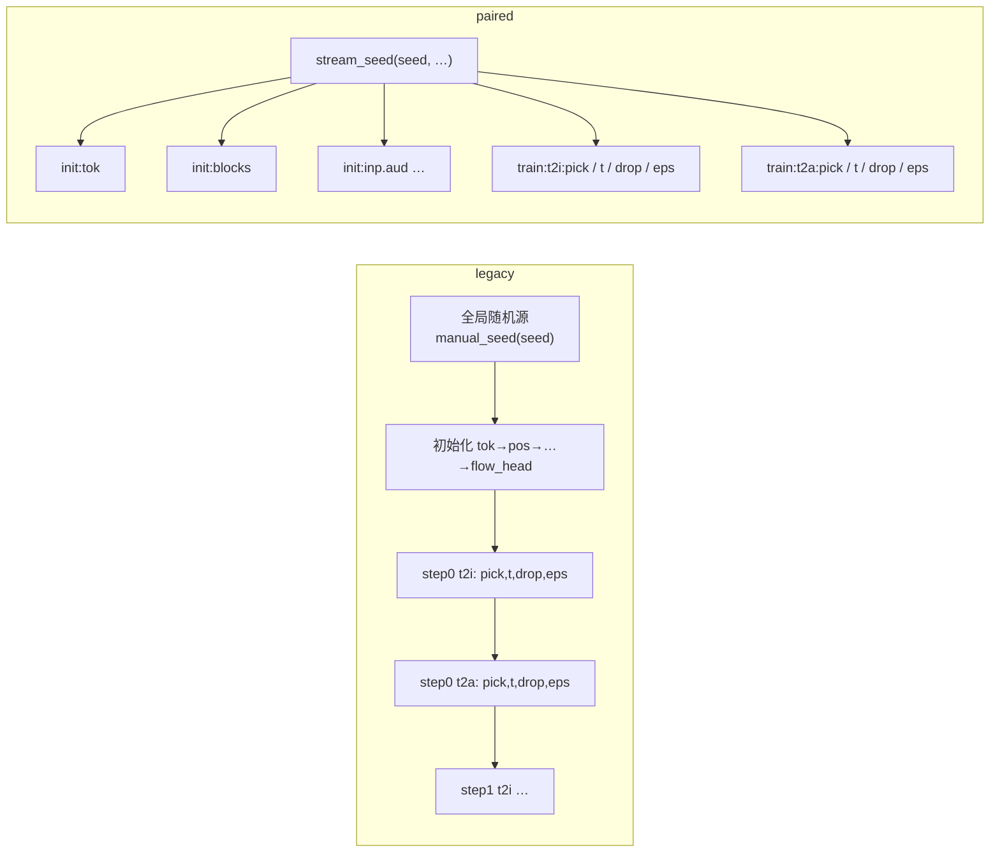

# 03 · 随机协议与可复现

第 4 集要做好几组「只改一处」的对照:潜变量 vs 波形,带 0 道 vs 带 N 道旧题。要让对照公平,就得保证两边除了要比的那一处,其余随机因素完全相同。第 2 集所有随机数都从同一个全局随机源里取,做不到这一点。第 4 集为此加了一套新的随机协议,另外配了一圈「运行身份」记录和防覆盖保护。

## 1. 问题:全局随机数会「串」

第 2 集的随机数来源:

```python
torch.manual_seed(0)                                   # main 里一次
model = Sparrow(...)                                   # 各部件按构造顺序吃全局随机数
t = torch.sigmoid(torch.randn(B, device=dev))          # 训练循环里 t、drop、eps、抽样都吃全局随机数
```

结果是牵一发而动全身:

- **改一个部件,其他部件的初始化全变。** 比如加一种模态,`MODS` 里多一项,`inp`、`where` 多建几个参数,排在后面的 `blocks` 拿到的随机数就全不一样了。
- **改一个任务的批大小,别的任务抽到的样本全变。** t2i 从 512 条改成 51 条,同一步里 t2i 少消耗了随机数,接下来 t2a 抽到的录音、时间 `t`、噪声就全换了。4-3 恰恰要改 t2i 的批大小、再比 t2a。
- **评测时第 i 道题用什么噪声,取决于前面的任务用掉了多少随机数。**

## 2. 新协议 `--rng paired`〔ep04 新增〕

```
--rng legacy   全部吃全局随机数(和九月训出的权重一致;主线 course_ep4 用的就是它)
--rng paired   初始化按部件、训练按「任务 × 用途」各用一条独立随机流(4-1、4-2、4-3 用它)
```

### 2.1 随机流的种子:`stream_seed`

[sparrow.py:207-209](../code/sparrow.py#L207)

```python
def stream_seed(seed, *names):
    """新随机协议里每条随机流的种子:由训练种子和流的名字决定,和别的流用了多少随机数无关。"""
    return int(hashlib.sha256(":".join(map(str, (seed, *names))).encode()).hexdigest()[:15], 16)
```

每条流的种子 = `sha256("训练种子:用途:名字")` 的前 15 位十六进制数。只要名字相同,得到的种子就相同,和其他流用了多少随机数无关。

### 2.2 初始化:每个部件一条流

[sparrow.py:226-272](../code/sparrow.py#L226)

```python
def make(name, build):
    if seed is None:                                   # legacy:照旧按构造顺序吃全局随机数
        return build()
    with torch.random.fork_rng(devices=[]):            # paired:临时切到这个部件自己的随机流
        torch.manual_seed(stream_seed(seed, "init", name))
        return build()

self.tok = make("tok", emb(len(VOCAB)))
self.pos = make("pos", emb(maxlen))
self.temb = make("temb", lambda: nn.Sequential(...))
self.inp = nn.ModuleDict({m: make(f"inp.{m}", ...) for m ... in MODS.items()})
self.where = nn.ParameterDict({m: make(f"where.{m}", ...) ...})
self.blocks = make("blocks", lambda: nn.ModuleList(Block(dim, heads) for _ in range(depth)))
...
```

- `tok`、`pos`、`temb`、`inp.<模态>`、`where.<模态>`、`when.<模态>`、`blocks`、`norm`、`text_head`、`flow_head.<模态>`,各自在名字对应的随机流里初始化。
- 效果:**同名同形的部件,在任何配置下初始值都一样。** 多一种模态只会多出几个部件,不会影响 `blocks` 的初始值。
- legacy 分支保持原有的构造顺序(`emb` 在 legacy 下不当场重设,留到最后统一 `normal_`),所以 `seed=None` 时初始化和第 2 集**逐位相同**。

### 2.3 训练:每个「任务 × 用途」一条流

[sparrow.py:494-505](../code/sparrow.py#L494)

```python
class Streams:
    def __init__(self, seed, tasks, alias=None):
        self.alias = alias or {}
        self.g = {(t, u): torch.Generator(device=dev).manual_seed(stream_seed(seed, "train", self.alias.get(t, t), u))
                  for t in tasks for u in ("pick", "t", "drop", "eps")}
```

每个任务有 4 条流:

| 用途 | 用在哪 |
|---|---|
| `pick` | `Cache.get` 抽哪几条样本 |
| `t` | logit-normal 采时间 `t` |
| `drop` | 10% 去掉条件 |
| `eps` | 加噪用的标准正态噪声 |

`train` 里把它们一一接上([sparrow.py:521-539](../code/sparrow.py#L521)):

```python
rs = Streams(a.seed, a.tasks, getattr(a, "stream_alias", None)) if a.rng == "paired" else (lambda task, use: None)
...
slots, segs = data.get(task, B, rs(task, "pick"))
t = torch.sigmoid(torch.randn(B, device=dev, generator=rs(task, "t")))
drop = (torch.rand(B, device=dev, generator=rs(task, "drop")) < 0.1) if lay.slots else None
g = rs(task, "eps")
eps = torch.randn_like(x1) if g is None else torch.randn(x1.shape, device=dev, generator=g)
```

legacy 下 `rs(...)` 返回 `None`,`generator=None` 就退回全局随机数,行为和第 2 集一样。

**`alias`(配对身份)**:`ep1_assets.py` 里像素版任务 `t2p` 的 alias 是 `t2i`,波形版 `t2w` 的 alias 是 `t2a`。随机流按配对身份取,所以两版抽到同样的样本序号、同样的 `t`、同样的去条件。只有噪声 `eps` 的**形状**不同(维数不一样),抽出来的数自然不同。详见 [05](05-表示方案对照-ep1_assets.md)。

### 2.4 一张图看两种协议



legacy 是一条长链,前面多消耗一个随机数,后面的全部错位;paired 是互不相干的并列分支。

### 2.5 评测噪声:每道题一团〔ep04 新增〕

[sparrow.py:624-626](../code/sparrow.py#L624)

```python
def eval_noise(lay, n, seed, first=0):
    """评测的起点噪声:第 i 题(从 first 起编号)单独按种子 seed*10000+i 生成,和别的题、别的任务用了多少随机数无关。"""
    return torch.cat([start_noise(lay, 1, seed * 10000 + i) for i in range(first, first + n)])
```

第 2 集的 `evaluate` 开头是 `torch.manual_seed(1234)`,之后各任务依次吃全局随机数。第 4 集去掉了这一行,`draw()` 改为给每道题传入 `x0=eval_noise(...)`。好处:

- **同一个 `--eval_seed` 下,不同权重的同一道题从同一团噪声出发**,可以逐题比较。
- 多评一个任务、少评一个任务,都不影响其他任务的题。

> **注意**:旧报告(第 2 集,以及 `course_ep4`、`course_ep4_only_t2a`)用的是全局种子 1234。新旧两种口径的数字**不能拼在同一条曲线上**。新报告的 `eval_config.noise` 字段里特意写明了这一点。

## 3. 运行身份:哈希与 `init.json`〔ep04 新增〕

### 3.1 参数哈希

[sparrow.py:212-223](../code/sparrow.py#L212)

```python
TRUNK = ("tok.", "pos.", "temb.", "blocks.", "norm.", "text_head.")      # 公共主干:各配置都有、同名同形的部分

def params_sha256(state, prefixes=None):
    """参数的哈希(按名字排序,名字、形状、float32 字节都算进去);prefixes 给了就只算这些前缀的参数。"""
```

`TRUNK` 是不随表示方案变化的那部分参数(不含 `inp`、`where`、`when`、`flow_head`)。成对对照的两版,只要 `trunk_init_sha256` 相同,就证明公共主干的起点完全一致。

### 3.2 `init.json`:起跑就写

[sparrow.py:1023-1029](../code/sparrow.py#L1023) 的 `identity()` 生成以下内容,`main` 在**训练开始前**就把它原子写入 `O/init.json`([sparrow.py:1130](../code/sparrow.py#L1130)):

| 字段 | 含义 |
|---|---|
| `attempt` | 排队脚本传入的环境变量 `SPARROW_ATTEMPT`,用来区分重跑 |
| `rng`、`seed` | 随机协议与训练种子 |
| `built_sha256_all` | 刚构造出来(随机初始化后)的全部参数哈希 |
| `trunk_init_sha256` | 刚构造出来的公共主干哈希,成对的两版用它核对 |
| `param_sha256` | 逐个参数的形状与哈希 |
| `start_sha256_all` | **实际训练起点**的哈希:从零训练时等于构造值;`--init` / `--eval_only` 时是加载权重之后的 |
| `start` | `random_init`、`init:<上一集 final.pt 的 sha256>` 或 `eval_only:<ckpt 的 sha256>` |

起跑就写,是为了让成对的两版一启动就能核对,不必等训练跑完。

### 3.3 report.json 的新字段

| 字段 | 内容 |
|---|---|
| `init` | 同 `init.json` |
| `init_sha256` | `--init` 那份权重文件的 sha256 |
| `data_sha256` | `world_train.npz`、`world_test.npz`、`voice.npz`、`labels.npz` 各自的 sha256 |
| `proj_params` | 用到的各模态入口投影的参数量,如 `{"aud": 49536, "img": 12672}` |
| `train_subset`、`train_data` | 训练子集的说明与实际条数(见 06) |
| `stat_source` | 每种统计量从哪来(见 [02](02-接续训练与旧题回放.md)) |
| `batch_per_step`、`exposure` | 见 [02](02-接续训练与旧题回放.md) |
| `train_peak_mem_GB`、`midway_eval_peak_mem_GB`、`eval_peak_mem_GB` | 训练、中途评测、终评的显存峰值**分开记**。第 2 集只取一次 `max_memory_allocated`,中途评测的显存会混进训练峰值 |
| `eval_config` | CFG、采样步数、评测种子、评测任务、噪声口径 |

## 4. 不覆盖、不写坏〔ep04 新增〕

### 4.1 `fresh_out`:输出目录必须是新的

[sparrow.py:1002-1013](../code/sparrow.py#L1002)

- `--out` 里已经有运行产物就拒绝写入。运行产物包括:任意权重文件(`.pt/.pth/.ckpt/.safetensors/.bin`)、`report.json`、`summary.json`、`init.json`、`records.json`、`samples/`、`step<N>/`。
- `--out` 落在别的运行目录里面(比如 `runs/x/step1000`)也拒绝。
- 要重跑,先手动删掉旧目录。

第 2 集的 `os.makedirs(a.out, exist_ok=True)` 会悄悄覆盖旧结果;而第 2 集的 `--eval_only` 恰恰要求往训练目录里写,两者相冲突。所以下面的 `--eval_only` 也一并改了。

### 4.2 `write_json`:原子写

[sparrow.py:1016-1020](../code/sparrow.py#L1016):先写临时文件,再 `os.replace`。读的一方(比如一边训练一边画曲线的脚本)不会读到半个 JSON。

## 5. `--eval_only --ckpt`:评测任意一份权重〔ep04 改写〕

第 2 集:`--eval_only` 读 `--out/final.pt`,再替换 `--out/report.json` 里的评测部分。

第 4 集([sparrow.py:1083-1093](../code/sparrow.py#L1083)):

```python
ck = torch.load(a.ckpt, map_location=dev)
trained = with_defaults(ck["args"])
for k in DEFAULTS:                        # 结构与训练子集照那份权重
    setattr(a, k, trained[k])
a.rng, a.seed = trained.get("rng", "legacy"), trained.get("seed", 0)
a.eval_tasks = a.eval_tasks.split(",") if a.eval_tasks else trained.get("eval_tasks") or trained["tasks"]
a.tasks, a.steps, a.init = [], 0, None
```

- 用 `--ckpt` 指定评哪一份权重,报告和样例写进**新的** `--out`(受 `fresh_out` 保护)。
- 结构和训练子集都按那份权重的参数来;统计量以 `strict=True` 模式从权重里取,缺一样就报错(见 [02](02-接续训练与旧题回放.md))。
- 可以换 `--eval_seed` 或 `--cfg` 重评,report 的 `eval_only` 字段会记下 ckpt 路径、sha256 和它的训练参数。

例如,用新的评测口径重评主线权重:

```bash
python sparrow.py --data "$W/data" --cache "$W/cache" --judges "$W/judges" \
  --out "$W/runs/eval_course_ep4" --eval_only --ckpt ../weights/course_ep4/final.pt
```

## 6. 没卡也能冒烟〔ep04 新增〕

`sparrow.py`、`encode.py`、`frozen.py` 都把 `dev = "cuda"` 改成了:

```python
dev = "cuda" if torch.cuda.is_available() else "cpu"   # 没有卡时在 CPU 上跑(只用于冒烟)
```

配套改动:`peak()` / `reset_peak()` 没卡时返回 0;`midway` 没卡时不存取 CUDA 的随机数状态;`train` 末尾的 `torch.cuda.synchronize()` 只在有卡时调用。`infer.py` 直接用 `S.dev`。CPU 只用来验证代码能跑通,训练还得用 CUDA 显卡。
