# 第 4 集代码解析:相对第 2 集多了什么

第 2 集(`ep02-t2i`)训练麻雀画图(t2i);第 4 集(`ep04-t2a`)接着第 2 集的权重,让同一个主干学会**念动物名(t2a)**,同时用旧题回放保住画图。

先说一个容易误会的地方:**「文字→声音」的骨架在第 2 集的代码里就已经有了。** 第 2 集的 [`sparrow.py`](../../ep02-t2i/code/sparrow.py) 已经有 `aud` 模态、t2a 序列模板、Mimi 解码、Paraformer 判卷和 `--weights t2a=4`,只是那一集没训练这一项,文档里也只是点到为止。所以第 4 集真正新增的,大部分不在「怎么生声音」本身,而在下面几块:

> **录音从哪来 + 怎么接着上一集练 + 怎么让对照实验公平、可复现。**

1. **录音流水线**(全新文件):用 CosyVoice 克隆 FLEURS 真人音色来念动物名,用 Whisper 当筛子、Paraformer 当裁判把关(`voice/`、`asr.py`、`check_voice.py`)。
2. **课程接续**:`--init` 接上一集权重时,上一集的归一化统计量原样沿用,只有本集新加的模态才现算;结构参数从权重里重建(`DEFAULTS` / `configure` / `Cache`)。
3. **旧题回放**:`--bs_task t2i=N` 单独设定每轮带几道画图题,用来量「带多少旧题才不忘」(4-2、4-3)。
4. **新的随机协议 `--rng paired`**:初始化按部件、训练抽样按「任务 × 用途」各用一条独立随机流,让成对对照只差要比的那一处。
5. **评测与可复现**:每道题单独生成起点噪声,最近邻改了口径,运行目录防覆盖,写 `init.json` 和各种哈希,`--eval_only --ckpt` 可以评任意一份权重。
6. **表示方案对照脚本 `ep1_assets.py`**:比较 Mimi 潜变量和直接波形(4-1)。
7. 还有一批**本集没用到的开关**(留出组合、逐帧视频潜变量、看图换编码器等),是给别的集的对照实验准备的。

## 总览:新增落在哪

```mermaid
flowchart LR
    subgraph REC["① 造录音(ep04 新增,离线一次)"]
        direction TB
        F["voice/fetch.py<br/>下载 FLEURS、CosyVoice、Whisper"] --> P["voice/speak.py pick<br/>挑参考音色"]
        P --> S["voice/speak.py say<br/>CosyVoice 合成 + Whisper 当场听写(筛子)"]
        S --> D["data.py voice<br/>去静音、补到 2.08 秒"]
        D --> C["check_voice.py<br/>Paraformer 把关(裁判),剔除差音色"]
    end

    subgraph ENC["② 编码(ep02 已有,ep04 小改)"]
        E["encode.py --parts img,aud<br/>train_wavs 抽成函数;CPU 兜底;新增 vidimg"]
    end

    subgraph TR["③ 训练 sparrow.py(ep04 大改)"]
        direction TB
        I["--init 上一集权重<br/>沿用归一化统计量"] --> R["--rng paired 独立随机流<br/>--bs_task 旧题回放"]
        R --> V["evaluate:每题独立噪声、最近邻、分音色<br/>init.json / 哈希 / fresh_out"]
    end

    subgraph USE["④ 使用"]
        direction TB
        INF["infer.py<br/>--seed/--noise/--record/--nearest/--stat_from"]
        X["ep1_assets.py<br/>潜变量 vs 波形(4-1)"]
    end

    C -->|"data/voice.npz"| E
    E -->|"cache/aud.npz"| I
    V -->|"final.pt"| INF
    E --> X
```

## 逐文件差异

| 文件 | 状态 | 一句话 | 详见 |
|---|---|---|---|
| [`sparrow.py`](../code/sparrow.py) | **大改**(601 → 1159 行) | 随机协议、统计量继承、旧题回放、评测改进、运行安全、可选表示 | 02、03、04、06 |
| [`asr.py`](../code/asr.py) | **新增** | Whisper(筛子)和 Paraformer(裁判)两个识别器;按拼音判对。第 2 集的 sparrow.py 已经 `from asr import Paraformer`,但第 2 集目录里没有这个文件 | 01 |
| [`check_voice.py`](../code/check_voice.py) | **新增** | 用 Paraformer 给全部录音把关,音色正确率低于 95% 的整个剔除 | 01 |
| [`voice/`](../code/voice/) | **新增** | `fetch.py` / `speak.py` / `run.sh`:在 TTS 容器里合成录音 | 01 |
| [`ep1_assets.py`](../code/ep1_assets.py) | **新增**(取代 `ep3_assets.py`) | 表示方案对照:同主干只换表示(图:潜变量/像素;声音:潜变量/波形)。和第 2 集的 `ep3_assets.py`(一步步生成、扫步数和 CFG 等素材)不是同一个脚本 | 05 |
| [`infer.py`](../code/infer.py) | 修改 | 能换种子或指定噪声文件,能调 CFG 和步数,可记录调用、找最近邻、借统计量;视频输入多了几种格式 | 04 |
| [`encode.py`](../code/encode.py) | 小改 | `wav()` 提成模块级的 `train_wavs()`(给 ep1_assets 复用);CPU 兜底;新增 `vidimg` 零件 | 01、06 |
| [`data.py`](../code/data.py) | 小改 | 只剩 `world` 和 `voice` 两个子命令(第 2 集多一个 `world_hd`,本文不展开) | 01 |
| [`frozen.py`](../code/frozen.py) | 一行 | `dev` 没卡时退回 CPU | 03 |
| `parts.py`、`train_judges.py`、`world/` | 不变 | 逐字节相同 | — |
| `requirements.txt` | 新增 | 钉死版本;多了 `funasr`、`pypinyin`、`librosa` | — |
| `data/voice.npz` | 新增 | 已把关的 432 条录音(324 条训练、108 条测试,12 个音色) | 01 |

## 阅读路线

| 篇 | 内容 | 适合先读的人 |
|---|---|---|
| [01-文字到声音全链路](01-文字到声音全链路.md) | 从造录音到念出名字再被判对,整条链路;每节标明「ep02 已有」还是「ep04 新增」 | 想知道麻雀怎么念名字 |
| [02-接续训练与旧题回放](02-接续训练与旧题回放.md) | `--init` 的统计量继承、`DEFAULTS`/`configure`、`--bs_task` 和中途评测相关开关;对应 4-2、4-3、4-4 | 想知道「接着练」和「不忘旧本事」 |
| [03-随机协议与可复现](03-随机协议与可复现.md) | `legacy` 与 `paired` 两种随机协议、各种哈希、`init.json`、`fresh_out`、`--eval_only --ckpt` | 想复现或自己做对照实验 |
| [04-评测与推理的变化](04-评测与推理的变化.md) | `evaluate` 中本集用到的改动;`infer.py` 的新参数 | 想看懂 report.json、用好 infer.py |
| [05-表示方案对照-ep1_assets](05-表示方案对照-ep1_assets.md) | `ep1_assets.py`:潜变量 vs 波形/像素;4-1 | 想知道「为什么要压成潜变量」 |
| [06-本集未用到的开关](06-本集未用到的开关.md) | `--hold`、`--per_combo`、`--see_from`、`--vid_lat`、`--watch_frames`、`--voices`、`--a2i_shuffle`、视频的两把尺子 | 读代码时碰到这些、想知道是干嘛的 |

建议按 01 → 02 → 03 → 04 的顺序读;05 和 06 按需查阅。没读过第 2 集文档的,先看 [ep02-t2i/docs](../../ep02-t2i/docs/README.md),本文默认读者已经了解流匹配、序列模板和注意力掩码。

## 新 sparrow.py 代码地图

带 ★ 的是第 4 集新增的整段;不带 ★ 的第 2 集就有,但多数有小改。

| 行号 | 内容 | 详见 |
|---|---|---|
| [1–24](../code/sparrow.py#L1) | 文件说明,多了 `--seed`/`--eval_seed`/`--eval_only --ckpt` 的说明 | — |
| [44–62](../code/sparrow.py#L44) | `dev`(CPU 兜底)、`MODS`、`TASKS`、`TEMPLATES`;★ `BASE_TEMPLATES` | 03、06 |
| ★ [70–96](../code/sparrow.py#L70) | `DEFAULTS`、`with_defaults`、`configure`、`watch_index` | 02、06 |
| ★ [98–134](../code/sparrow.py#L98) | `combos`、`pick_images`、`pick_voices` | 06 |
| [137–183](../code/sparrow.py#L137) | `needs`、`Layout`(不变) | — |
| ★ [207–223](../code/sparrow.py#L207) | `stream_seed`、`TRUNK`、`params_sha256` | 03 |
| [226–303](../code/sparrow.py#L226) | `Sparrow`:构造改成按部件独立初始化(`make`) | 03 |
| [306–343](../code/sparrow.py#L306) | `tokens`/`untokens`(多了 `vid_img`)、`FIELD`、★ `FILE`、`norm`/`denorm` | 06 |
| ★ [346–357](../code/sparrow.py#L346) | `task_mods`、`run_mods`:上一集用过哪些模态 | 02 |
| [360–474](../code/sparrow.py#L360) | `Cache`:先定训练子集,再定统计量来源,最后归一化;`get` 接受随机流 | 02、06 |
| ★ [489–514](../code/sparrow.py#L489) | `batch`、`Streams`、`peak`/`reset_peak` | 02、03 |
| [517–601](../code/sparrow.py#L517) | `train`、★ `save`、`midway` | 02、03 |
| [604–615](../code/sparrow.py#L604) | `load`:改用 `with_defaults` + `configure` 重建 | 02 |
| [618–627](../code/sparrow.py#L618) | `start_noise`、★ `eval_noise` | 03 |
| [630–661](../code/sparrow.py#L630) | `generate`、`describe`(不变) | — |
| ★ [668–715](../code/sparrow.py#L668) | `topk_rmse`、`rmse_to`、`paired_test`、`nearest` | 04 |
| ★ [718–757](../code/sparrow.py#L718) | `video_rulers`、`VALID_FRAME_ACC`、`video_calibration` | 06 |
| ★ [760–791](../code/sparrow.py#L760) | `mismatch_perm` | 06 |
| [794–978](../code/sparrow.py#L794) | `evaluate` | 01、04、06 |
| ★ [981–1029](../code/sparrow.py#L981) | `sha256`、`run_products`、`fresh_out`、`write_json`、`identity` | 03 |
| [1032–1155](../code/sparrow.py#L1032) | `main`:新增十几个参数,流程重排 | 02、03 |

## 本集的实测数字(出处)

文档引用的数字都出自仓库里的这几处:

- [`../README.md`](../README.md) 第 4 节:四份发布权重的画图和念名字正确率。
- [`../EXPERIMENTS.md`](../EXPERIMENTS.md):4-1(两种声音表示)、4-2/4-3(带多少画图题)、4-4(主线训练进度)。
- `weights/<名字>/report.json`:训练参数、loss 记录和终评。其中 `course_ep4` 与 `course_ep4_only_t2a` 是用较早版本的代码训的(随机协议为 legacy),report 里没有 `init`、`stat_source`、`eval_config` 等新字段;`replay_0` 与 `replay_512` 是用当前代码以 `--rng paired` 训的,字段齐全。

> **注意 · LFS 文件**:`code/sparrow.py`、`data/voice.npz`、`weights/*/final.pt` 和 `samples/*.wav` 在仓库里都是 Git LFS 文件。没装 git-lfs 时,本地拿到的只是一个 3 行的指针。可以从 ModelScope 下载真实文件,再用 `shasum -a 256` 对照 [`MANIFEST.sha256`](../MANIFEST.sha256) 核对。
