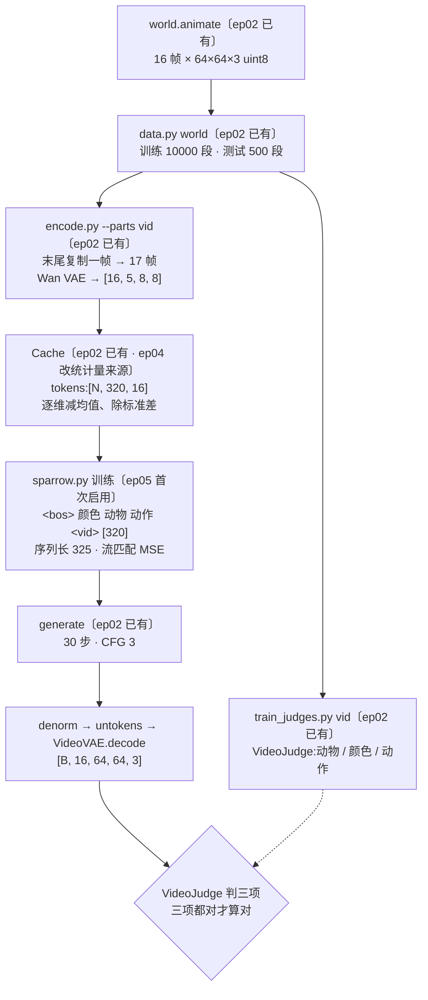

# 01 · 文字到视频:一段动画的一生

本篇跟着一段「红色 小猫 向左跑」走一遍:程序画出 16 帧,冻结的 Wan VAE 把它压成 5 个时间槽,排成 320 个向量进主干训练;生成时从噪声走回潜变量,解码成 16 帧,再交给视频判卷器判颜色、动物和动作。

每节标题后面标了出处:

- **〔ep02 已有〕**:第 2 集的代码里就有,第 2、4 集都没训练这一项。
- **〔ep04 新增〕**:第 4 集加的,第 4 集没用上。
- **〔ep05 首次启用〕**:代码早就有,本集第一次真正跑起来。

本集代码和第 4 集逐字节相同,所以下面的行号对两集都成立。

## 0. 全链路一张图



## 1. 造动画:`world.animate`〔ep02 已有〕

[world.py:346-380](../code/world/world.py#L346)。每段动画先随机定场景(动物、颜色、背景、缩放 0.55~0.65),再按动作画 16 帧(`FRAMES = 16`):

| 动作 | 每帧怎么变 |
|---|---|
| `run_left` / `run_right` | 水平从一边匀速跑到另一边,朝向跟着方向;腿按 `phase` 摆动,身体上下轻微颠 |
| `jump` | 高度走一条抛物线 `4·75·u(1-u)`,同时往前带一点位移;中间几帧收腿(`tuck`) |
| `turn` | 前 8 帧朝右、后 8 帧朝左;水平缩放 `max(0.12, |cos(πu)|)`,中间几帧几乎被压成一条竖线 |

`turn` 和 `jump` 中间那几帧的画面很特殊(压扁、离地),第 4 篇会看到:**图判卷器**在这几帧上最容易判错。

[data.py:26-30](../code/data.py#L26) 的 `one_vid` 给每段动画单独一颗种子:动作从 4 种里均匀抽,种子 = 起始种子 + 50,000,000 + 序号(和图的种子错开)。README 里的两条命令:

```bash
python data.py world "$W/data/world_test.npz" 2000 500 900000000   # 测试:500 段动画
python data.py world "$W/data/world_train.npz" 60000 10000 0       # 训练:10000 段动画
```

训练和测试的种子区间不重叠,所以测试动画一段都没在训练里出现过。

## 2. 视频判卷器:`VideoJudge`〔ep02 已有〕

[parts.py:54-70](../code/parts.py#L54)、[train_judges.py:43-50](../code/train_judges.py#L43)。一个和主模型无关、只用真动画训的小分类器:

```python
h = self.f(v.flatten(0, 1)).view(B, T, -1)        # 逐帧 CNN → [B, 16, 128]
s = h.mean(1)                                      # 颜色、动物:16 帧取平均
ht = self.t(h.transpose(1, 2))                     # 时间上两层一维卷积
a = torch.cat([ht.mean(2), (ht[:, :, T // 2:].mean(2) - ht[:, :, :T // 2].mean(2))], 1)   # 动作:平均 + 后半减前半
```

判动作时特意加了「后半段减前半段」,这样「向左跑」和「向右跑」这种只差方向的动作也能分开。训练 1500 步,每步 16 段。

## 3. 压成潜变量:`VideoVAE`〔ep02 已有〕

[frozen.py:41-57](../code/frozen.py#L41)。Wan2.1 的时空 VAE 是**因果**的:第 1 帧单独压,之后每 4 帧压成 1 帧,所以输入要 1 + 4k 帧。16 帧凑不成,就在末尾复制最后一帧,凑成 17 帧:

```python
def encode(self, u8):                           # [B, 16, 64, 64, 3] -> [B, 16, 5, 8, 8]
    x = u8_to_pm1(u8).transpose(1, 2)           # [B, 3, T, H, W]
    x = torch.cat([x, x[:, :, -1:]], 2)         # 17 帧
    return self.m.encode(x).latent_dist.mode()

def decode(self, z):                            # -> [B, 16, 64, 64, 3]
    return pm1_to_u8(self.m.decode(z).sample[:, :, :16].transpose(1, 2))   # 丢掉补的那一帧
```

压缩后时间方向变成 **5 个时间槽**,空间 64×64 变成 8×8,通道 16。每个槽管哪几帧:

| 时间槽 | 0 | 1 | 2 | 3 | 4 |
|---|---|---|---|---|---|
| 原始帧 | 第 0 帧 | 1–4 | 5–8 | 9–12 | 13–16(16 是复制的第 15 帧) |

这张表在第 2 篇很重要:槽与槽的交界在第 0→1、4→5、8→9、12→13 帧之间。

[encode.py:87-93](../code/encode.py#L87) 的 `vid` 零件用 bf16 编码全部训练、测试动画,再拿前 200 段测试片「压了再还原」交给判卷器,量这条路的上限。[`reports/encoding.json`](../reports/encoding.json) 里 `vid` 的实测:

| 字段 | 值 |
|---|---|
| `params_M` | 126.9(Wan VAE,冻结) |
| `latent` | `[16, 5, 8, 8]` |
| `recon_animal_acc` / `recon_color_acc` / `recon_action_acc` | 1.0 / 1.0 / 1.0 |
| `encode_seconds` | 82.2 |
| `peak_mem_GB` | 4.12 |
| `cache_MB` | 107.5 |

还原后判卷器三项全对,说明「压时间」这一步本身没有丢掉判卷要看的信息。

## 4. 排成向量:`tokens` 与归一化〔ep02 已有 · ep04 改统计量来源〕

[sparrow.py:306-328](../code/sparrow.py#L306)。缓存里每段是 `[16, 5, 8, 8]`(通道、时间、高、宽),进主干前排成 320 个 16 维向量,**按时间槽排**,槽内按行、列:

```python
if name == "vid_lat":                   # [N, 16, 5, 8, 8] -> [N, 5*64, 16],按帧排
    return x.permute(0, 2, 3, 4, 1).reshape(x.shape[0], -1, x.shape[1])
```

`untokens` 做反向操作,生成完交给解码器之前还原形状。

归一化([sparrow.py:336-343](../code/sparrow.py#L336))是逐维(16 维各一组)减均值、除标准差。这组统计量是本集**第一次算**:`Cache` 发现上一集(第 4 集)没用过 `vid`,就按全部 10000 段训练动画现算。[`reports/progress/final.json`](../reports/progress/final.json) 的 `stat_source` 记着:

```json
{"aud": "ckpt", "img": "ckpt", "vid": "现算:训练动画 10000 段(本集新加的模态)"}
```

来龙去脉见第 3 篇。

## 5. 进主干:三种位置信息〔ep02 已有〕

`MODS["vid"] = (16, 64, 5, True)`([sparrow.py:46](../code/sparrow.py#L46)):每个向量 16 维、每槽 64 个、5 个槽、是生成用的潜变量。构造模型时据此建 4 样视频专用部件([sparrow.py:259-269](../code/sparrow.py#L259)):

| 部件 | 形状 | 作用 |
|---|---|---|
| `inp.vid` | `Linear(16, 384)`,6528 个参数 | 16 维潜变量 → 主干宽度(`proj_params.vid = 6528`) |
| `where.vid` | `[64, 384]` | 槽内位置:8×8 里的第几格 |
| `when.vid` | `[5, 384]` | 时间位置:第几个槽(只有 `f > 1` 的模态才有) |
| `flow_head.vid` | `Linear(384, 16)`,零初始化 | 生成出口:预测速度 |

`embed`([sparrow.py:274-281](../code/sparrow.py#L274))把三样加在一起:

```python
pos = self.where[mod].repeat(f, 1)                          # 帧内位置,5 个槽共用
if f > 1:
    pos = pos + self.when[mod].repeat_interleave(n, 0)      # 时间位置:第几帧
h = h + pos
return h + self.temb(sinus(t))[:, None] if g else h         # 再加噪声时间 t
```

外面还有一层整条序列共用的 `pos`(第几个位置)。

> **注意 · 这些部件从第 2 集起就在权重里**:`Sparrow` 不管练哪几项,都按 `MODS` 把全部模态的部件建出来,所以第 2、4、5 集的参数量都是 16.04M。第 2、4 集没练 t2v,这些部件没收到过梯度(`AdamW` 跳过 `grad is None` 的参数,也就不做权重衰减),停在第 2 集构造时的初值。最直接的证据是主线第 0 步的损失:`t2v` 是 **1.9957**,而 `t2i` 只有 0.2755([`weights/course_ep5/report.json`](../weights/course_ep5/report.json) 的 `log[0]`)。`flow_head.vid` 还是零,输出的速度恒为 0,损失就等于 `E[(x1 - eps)²]`;数据和噪声都是单位方差,这个值约等于 2。

## 6. 序列模板与训练〔ep05 首次启用〕

t2v 的模板([sparrow.py:54](../code/sparrow.py#L54)):

```python
"t2v": ["<bos>", "C", "A", "T", "<vid>", ("vid", True)],
```

5 个文字位(颜色、动物、动作三个词槽)+ 320 个视频位 = **序列长 325**(各份 report 的 `seq_len.t2v`)。默认 `--maxlen 400` 放得下。

训练这一步和画图、念名字共用同一段流匹配代码([sparrow.py:532-542](../code/sparrow.py#L532)):

1. `t` 取 logit-normal(中间的 t 多练);
2. 10% 的样本把三个词槽都换成 `<null>`,给 CFG 留一条无条件的路;
3. `x_t = (1 - t)·噪声 + t·数据`,主干预测速度 `v`,和 `数据 - 噪声` 算 MSE。

本集每步 t2v 取 128 段(`--bs_vid`),损失权重 1。主线 4000 步后 t2v 损失降到 0.0896(第 3900 步的记录)。批量和三任务的配合见第 3 篇。

## 7. 生成与解码〔ep02 已有〕

`generate`([sparrow.py:630-649](../code/sparrow.py#L630))从一团 `[1, 320, 16]` 的纯噪声出发,走 30 步欧拉,每步算一次有条件、一次无条件,按 CFG 3 合成:

```python
x = x + (u + cfg * (v - u)) / steps
```

走完以后,先 `denorm` 回原始尺度并 `untokens` 成 `[B, 16, 5, 8, 8]`,再交给 `VideoVAE.decode` 解成 17 帧,丢掉最后一帧,得到 `[B, 16, 64, 64, 3]` 的 uint8 动画。

## 8. 判对错〔ep02 已有 · ep04 扩充〕

生成的动画交给第 2 节的 `VideoJudge`,动物、颜色、动作**三项都对**才算对(`all_acc`)。主线终评([`weights/course_ep5/report.json`](../weights/course_ep5/report.json)):

| 指标 | 值 |
|---|---|
| `t2v.n` | 192 |
| `animal_acc` / `color_acc` | 1.0 / 1.0 |
| `action_acc` / `all_acc` | 0.9948(191/192) |

同一次终评里,旧题画图 `t2i.both_acc` 1.0(384/384),念名字 `t2a.sound_acc` 0.9792(235/240)。第 4 集在视频判卷器之外还加了「相邻帧变化」「逐帧一致」两把尺子和判卷器自检,本集是第一次跑出数,见第 4 篇。
