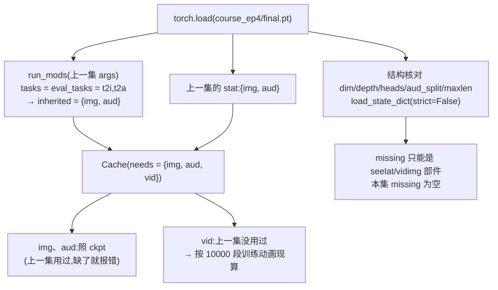

# 03 · 三任务接续训练:接第 4 集,三样一起练

本集主线命令(README 第 2 节):

```bash
python sparrow.py --data "$W/data" --cache "$W/cache" --judges "$W/judges" \
  --out "$W/runs/course_ep5" --init "$INIT" --tasks t2i,t2a,t2v \
  --steps 4000 --seed 0 --rng legacy --vid_attn full --eval_every 0
```

和第 4 集主线(`--tasks t2i,t2a --steps 8000 --eval_every 1000`)相比,只是 `--tasks` 多了 `t2v`,步数少一半,不做中途评测。这条命令背后用到的「接着练」机制都是第 4 集写好的(见 [ep04 docs/02](../../ep04-t2a/docs/02-接续训练与旧题回放.md)),本篇只讲**加进一个新模态**时,它们各自怎么处理视频。

## 1. `--init`:哪些照搬、哪些现算〔ep04 新增 · ep05 首次加新模态〕

[sparrow.py:1102-1123](../code/sparrow.py#L1102) 的流程:



三件事分开说:

**① 归一化统计量**。`Cache` 逐个模态决定来源([sparrow.py:405-433](../code/sparrow.py#L405)):上一集权重里有的(`img`、`aud`)照搬,标 `"ckpt"`;上一集本来就用、权重里却没有的,直接报错,不现算顶替;只有本集新加的模态才现算。`vid` 就是第三种情况。[`reports/progress/final.json`](../reports/progress/final.json) 记下的来源:

```json
"stat_source": {"aud": "ckpt", "img": "ckpt", "vid": "现算:训练动画 10000 段(本集新加的模态)"}
```

主线的 `weights/course_ep5/report.json` 是较早版本的代码写的,没有 `stat_source` 字段,但流程相同。训练结束后 `save` 把三组统计量一起存进 `final.pt`([sparrow.py:575-577](../code/sparrow.py#L575)),下一次推理、重评、或第 6 集接着练,都照这份。

**② 模型参数**。第 4 集的权重里本来就有全部视频部件(`inp.vid`、`where.vid`、`when.vid`、`flow_head.vid`,见 [01](01-文字到视频全链路.md) 第 5 节),所以 `load_state_dict(strict=False)` 不缺也不多,全部照搬。这些部件此前从没训练过,本集才第一次收到梯度。

**③ 结构核对**。`dim/depth/heads/aud_split/maxlen` 必须和上一集一致,否则退出([sparrow.py:1115-1117](../code/sparrow.py#L1115))。t2v 序列长 325,默认 `maxlen=400` 放得下,不用改;如果要换成逐帧表示(序列 1029),就必须改 `maxlen`,也就不能再 `--init` 第 4 集的权重了,见第 5 篇。

> **注意 · `init_sha256` 对不上 README 的哈希是正常的**:`reports/progress/final.json` 里 `init_sha256` 是 `3a8a66a7…`,README 下载命令核对的是 `2b7dfe25…`。发布时权重文件只替换了路径元数据,张量没动。[`../README.md`](../README.md) 第 2 节写明:发布的第 4 集参数和实验实际起点的全部 132 个模型及统计量张量已核验一致。

## 2. 每步怎么配三个任务〔ep02 已有 · ep04 抽成函数〕

`train`([sparrow.py:528-553](../code/sparrow.py#L528))每一步按 `--tasks` 的顺序,每个任务各取一批、各自前向、各自 `backward`,梯度累加起来,最后只做一次裁剪和一次 `opt.step()`。每个任务取多少条由 `batch` 决定([sparrow.py:489-491](../code/sparrow.py#L489)):

```python
def batch(a, task):
    return a.bs_task[task] if task in a.bs_task else (a.bs_vid if task in ("t2v", "v2t") else a.bs)
```

本集没写 `--bs_task`,所以:

| 任务 | 每步条数 | 损失权重 | 4000 步共见过 | 训练集大小 | 平均每条见过 |
|---|---:|---:|---:|---:|---:|
| t2i | 512(`--bs`) | 1 | 2,048,000 | 60,000 张图 | 约 34 次 |
| t2a | 512(`--bs`) | 4(`--weights t2a=4`,默认) | 2,048,000 | 1,296 行录音 | 约 1580 次 |
| t2v | 128(`--bs_vid`) | 1 | 512,000 | 10,000 段动画 | 约 51 次 |

「每步条数」「共见过」出自 `reports/progress/final.json` 的 `batch_per_step`、`exposure`;训练集大小出自同一份的 `train_data`(录音 1296 行 = 324 条训练录音 × 4 份时间平移)。视频每条 325 个位置,图只有 68 个,所以视频批量小,显存才放得下:主线训练张量显存峰值 7.06 GB。

旧题(t2i、t2a)每步照常练满 512 条,这就是本集的「旧题回放」,没有单独调比例。第 4 集 4-2、4-3 的实验已经量过「带多少旧题才不忘」,结论见 [ep04 docs/02](../../ep04-t2a/docs/02-接续训练与旧题回放.md)。本集主线终评旧题的成绩:画图 100%(384/384),念名字 97.9%(235/240)。

## 3. 两种随机协议用在哪〔ep04 新增〕

`--rng` 的两种协议在 [ep04 docs/03](../../ep04-t2a/docs/03-随机协议与可复现.md) 有完整说明。本集的几次运行分别是:

| 运行 | `--rng` | 为什么 |
|---|---|---|
| 主线 `course_ep5` | legacy | 和 README 发布的参数一致 |
| `course_ep5_frame` | legacy | 和主线成对:同种子、同起点、同抽样,只差掩码 |
| 进度曲线 `progress` | paired | 每 250 步评一次;独立随机流保证中途评测不打乱训练抽样 |
| 表示对照 `representation_*` | paired | 两版维度、序列长度都不同;paired 让公共主干的初始化相同,每步抽到的样本、时间 t、去条件也相同 |

`legacy` 下全部随机数都从全局 RNG 里按顺序取。`paired` 下每个任务的「抽样 / 时间 t / 去条件 / 噪声」各用一条独立的随机流(`Streams`,[sparrow.py:494-505](../code/sparrow.py#L494)),种子由训练种子和流的名字决定。另外,`midway` 进出时会保存并恢复全局 RNG 状态([sparrow.py:583](../code/sparrow.py#L583)、[598-600](../code/sparrow.py#L598)),中途评测的耗时也从训练时间里扣掉。

主线(legacy)和进度曲线(paired)是**两次不同的运行**:主线终评 99.5%,曲线末点 100%;训练耗时 1074.2 秒对 738.9 秒,显存峰值 7.06 GB 对 7.13 GB。这几组数不能混用。

## 4. 进度曲线〔ep05 首次启用〕

```bash
python sparrow.py ... --out "$W/runs/progress" --init "$INIT" --tasks t2i,t2a,t2v \
  --steps 4000 --seed 0 --rng paired --eval_every 250 --eval_tasks t2v
```

`--eval_every 250` 在第 250、500、…、3750 步各评一次(`eval_points` 不含最后一步,最后一步由终评负责),每次写 `step<N>/report.json`;`--eval_tasks t2v` 只评视频,省时间。仓库里整理成 [`reports/progress/step<N>.json`](../reports/progress/) 和 `final.json`。

| 步数 | 动物 | 颜色 | 动作 | 三项都对 |
|---:|---:|---:|---:|---:|
| 250 | 34.9% | 9.4% | 48.4% | 1.0%(2/192) |
| 500 | 60.4% | 42.2% | 94.8% | 21.4%(41/192) |
| 750 | 85.9% | 81.3% | 97.9% | 67.2%(129/192) |
| 1000 | 96.9% | 94.3% | 99.5% | 91.1%(175/192) |
| 1250 | 98.96% | 97.4% | 99.5% | 95.8%(184/192) |
| 1500 | 100% | 98.96% | 98.4% | 97.4%(187/192) |
| 1750 | 100% | 99.5% | 98.4% | 97.9%(188/192) |
| 2000 | 100% | 100% | 100% | 100% |
| 2250~3250 | 100% | 100% | 98.96%~99.48% | 98.96%~99.48% |
| 3500、3750 | 100% | 100% | 100% | 100% |
| 4000(终评) | 100% | 100% | 100% | 100%(192/192) |

几个读法:

- **动作学得最快**。第 500 步动作已经 94.8%,颜色才 42.2%。按未四舍五入的准确率,首次达到 99% 的是动作 1000 步、动物 1500 步(1250 步是 98.96%,差一点)、颜色 1750 步(1500 步也是 98.96%)。
- **「首次达到」不等于以后不回落**。动作在 1500、1750 步掉回 98.4%,2250~3250 步又在 99% 上下浮动。
- 每 250 步的数字只是一次评测、192 道题,差 1 道就是 0.5 个百分点。

损失记录在 `final.json` 的 `log` 里:t2v 从第 0 步的 1.9753 降到第 3900 步的 0.1119;旧题 t2i 0.2778 → 0.2755、t2a 0.2455 → 0.2236,基本没被新任务拖累。

## 5. 本集没用到的训练开关

`--bs_task`、`--stop_at`、`--eval_at`、`--keep_midway`、`--hold`/`--per_combo`、`--voices` 本集都没用,含义见 [ep04 docs/02](../../ep04-t2a/docs/02-接续训练与旧题回放.md) 和 [ep04 docs/06](../../ep04-t2a/docs/06-本集未用到的开关.md)。
