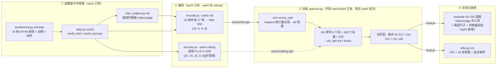

# 第 5 集代码解析:相对第 4 集、第 2 集多了什么

第 4 集(`ep04-t2a`)让麻雀学会念动物名,同时用旧题回放保住画图;第 5 集(`ep05-t2v`)接着第 4 集的权重,让同一个约 16.04M 参数的主干学**演动画(t2v)**:「红色 小猫 向左跑」→ 16 帧 64×64 的小动画。画图、念名字两种旧题一起练。

先说结论,免得读代码时找不到「新增」在哪:

> **第 5 集的 `code/` 和第 4 集逐字节相同,本集没有新写一行代码。而「文字→视频」这条线在第 2 集的代码里就已经有了。**

- `sparrow.py`、`encode.py`、`infer.py`、`frozen.py`、`data.py`、`parts.py`、`train_judges.py`、`asr.py`、`world/world.py` 都和 `ep04-t2a/code/` 一字不差,`requirements.txt` 也一样。[`PROVENANCE.json`](../PROVENANCE.json) 给每个代码文件都记了 `"changed": false`。
- 本集目录只是**少了**第 4 集的录音流水线:`voice/`、`check_voice.py`、`ep1_assets.py`,以及 `world/README.md`。录音改为直接下载第 4 集已把关的 `voice.npz`。
- 第 2 集的 [`sparrow.py`](../../ep02-t2i/code/sparrow.py) 就已经有 `vid` 模态([L42](../../ep02-t2i/code/sparrow.py#L42))、t2v 序列模板([L50](../../ep02-t2i/code/sparrow.py#L50))、Wan 视频 VAE、视频判卷器、`--vid_attn frame`([L558](../../ep02-t2i/code/sparrow.py#L558))、`--bs_vid` 和 evaluate 里的 t2v 段([L489](../../ep02-t2i/code/sparrow.py#L489)),只是那一集没训练这一项。
- 第 4 集又给视频补了几样:逐帧表示 `--vid_lat vidimg`、视频的两把尺子 `video_rulers` 和判卷器自检 `video_calibration`、`infer.py` 存起点噪声和逐帧原图。第 4 集文档的 [06 篇](../../ep04-t2a/docs/06-本集未用到的开关.md)把它们列为「本集未用到的开关」。

所以第 5 集真正新增的东西,不在代码,而在**怎么用这份代码**:

1. **第一次把 t2v 加进训练**:`--init` 第 4 集主线 + `--tasks t2i,t2a,t2v`。视频的归一化统计量本集现算,图和声音的沿用第 4 集。主干里从第 2 集起就有、但一直没收到梯度的视频部件,本集才开始被训练。
2. **注意力对照 full / frame**:同一份第 4 集参数分别训两份(`course_ep5`、`course_ep5_frame`),再用统一的评测口径重评一遍(`reports/attention_*.json`)。
3. **训练进度曲线**:换成 `--rng paired`,每 250 步评一次 t2v(`reports/progress/`)。
4. **两种视频表示的对照**:从零只练 t2v,Wan 时空潜变量和逐帧 FLUX.2 潜变量各训一份(`reports/representation_*.json`)。
5. **第 4 集写好、本集第一次跑出数的评测**:视频两把尺子、判卷器自检。逐帧判卷器在真动画上只有 90.9%,没过 97% 的校准线,所以逐帧一致率一律标为无效。

## 总览:一段动画从造出来到被判对

## 逐文件差异

「对 ep04」一列只看本目录和第 4 集目录的差别;「对 ep02」一列只说和**视频**有关的差别。和图、声音有关的改动(随机协议、统计量继承、旧题回放等)已经在[第 4 集文档](../../ep04-t2a/docs/README.md)里讲过。

| 文件 | 对 ep04 | 对 ep02(只看视频) | 详见 |
|---|---|---|---|
| [`sparrow.py`](../code/sparrow.py) | **相同** | ep04 新增 `--vid_lat vidimg`(`configure`、`tokens`/`untokens` 的 `vid_img`、evaluate 里的 `vmod` 分支)、`video_rulers`/`video_calibration`、按题号固定的评测噪声 `eval_noise`;`--init` 时允许 `vidimg` 部件新建初始化 | 01、02、03、04、05 |
| [`frozen.py`](../code/frozen.py) | **相同** | 只多了一行:`dev` 没卡时退回 CPU。`VideoVAE` 原样不动 | 01 |
| [`encode.py`](../code/encode.py) | **相同** | ep04 新增零件 `vidimg`(不在默认的 `--parts` 里);`vid` 零件不变 | 01、05 |
| [`infer.py`](../code/infer.py) | **相同** | ep04 新增:t2v 另存 `<名>_frames/`(16 张 png + `frames.npy`)和 `<输出>.noise.pt`;`--seed`/`--noise`/`--cfg`/`--steps`;`vidimg` 权重逐帧解码;v2t 能读 gif、npy、png 目录 | 04 |
| [`train_judges.py`](../code/train_judges.py)、[`parts.py`](../code/parts.py)、[`world/world.py`](../code/world/world.py) | **相同** | 相同(`VideoJudge`、`animate` 都是第 2 集的) | 01 |
| [`data.py`](../code/data.py) | **相同** | ep02 多一个 `world_hd` 子命令,ep04 删掉了;`one_vid` 不变 | 01 |
| [`asr.py`](../code/asr.py)、[`requirements.txt`](../code/requirements.txt) | **相同** | (第 4 集新增,和视频无关) | — |
| `voice/`、`check_voice.py`、`ep1_assets.py`、`world/README.md` | **本集没有** | — | — |
| [`EXPERIMENTS.md`](../EXPERIMENTS.md) | **内容全新** | — | 02、05 |
| [`reports/`](../reports/) | **本集新增** | — | 02、03、04、05 |
| [`PROVENANCE.json`](../PROVENANCE.json)、[`MANIFEST.sha256`](../MANIFEST.sha256) | 内容换成本集的 | — | 03 |

## 阅读路线

| 篇 | 内容 | 适合先读的人 |
|---|---|---|
| [01-文字到视频全链路](01-文字到视频全链路.md) | 一段动画的一生:`animate` 造片 → Wan VAE 压成 5 个时间槽 → 排成 320 个向量 → 流匹配生成 → 解码 → 判卷;每节标明出处 | 想知道麻雀怎么演动画 |
| [02-时间槽与注意力掩码](02-时间槽与注意力掩码.md) | 「帧」其实是时间槽;`Layout` 怎么让槽与槽互看或不互看;full/frame 对照的两种口径和相邻帧变化 | 想看懂 README 第 4 节的对照 |
| [03-三任务接续训练](03-三任务接续训练.md) | `--init` 时视频部件和统计量从哪来;三个任务每步怎么配批量和损失;`legacy` 与 `paired` 用在哪次运行;进度曲线 | 想复现主线、读懂 progress |
| [04-视频评测与推理](04-视频评测与推理.md) | evaluate 的 t2v 段、两把尺子、判卷器自检、report.json 字段;`infer.py t2v` | 想看懂 report、用好 infer.py |
| [05-视频表示对照](05-视频表示对照.md) | `--vid_lat vidimg` 改了哪些地方;Wan 和逐帧 FLUX.2 的实测对比 | 想知道「为什么先压时间」 |

建议按 01 → 02 → 03 → 04 的顺序读,05 按需查阅。本文默认读者已经读过 [ep02 docs](../../ep02-t2i/docs/README.md)(流匹配、序列模板、注意力掩码)和 [ep04 docs](../../ep04-t2a/docs/README.md)(接续训练、随机协议、评测噪声)。

## sparrow.py 里和视频有关的代码

行号指本集的 [`sparrow.py`](../code/sparrow.py)(和第 4 集同一份文件,行号也相同)。「出处」一列说这段是哪一集写的。

| 行号 | 内容 | 出处 | 详见 |
|---|---|---|---|
| [9–16](../code/sparrow.py#L9) | 文件说明里的七种序列,其中「文字→视频」「看视频」两行 | ep02 | 01 |
| [46–49](../code/sparrow.py#L46) | `MODS["vid"] = (16, 64, 5, True)`:16 维、每槽 64 个、5 个槽、生成用;`TASKS`、`GEN` | ep02 | 01 |
| [54](../code/sparrow.py#L54) | t2v 模板 `<bos> C A T <vid> [vid]` | ep02 | 01 |
| [71](../code/sparrow.py#L71) | `DEFAULTS` 里的 `vid_attn`、`vid_lat`、`maxlen` | ep04 | 03、05 |
| [88–90](../code/sparrow.py#L88) | `configure`:`vid_lat=vidimg` 时登记 `MODS["vidimg"]`、改写 t2v 模板 | ep04 | 05 |
| [142–180](../code/sparrow.py#L142) | `Layout`:`frame=True` 时每 64 个向量一块 | ep02 | 02 |
| [262–265](../code/sparrow.py#L262) | `where`(槽内位置)、`when`(第几个槽,只给 `f > 1` 的模态) | ep02 | 01 |
| [274–281](../code/sparrow.py#L274) | `embed`:槽内位置 + 时间位置 + 噪声时间 | ep02 | 01 |
| [306–328](../code/sparrow.py#L306) | `tokens`/`untokens`:`vid_lat` 是 ep02 的,`vid_img` 是 ep04 加的 | ep02 · ep04 | 01、05 |
| [346–357](../code/sparrow.py#L346) | `task_mods`、`run_mods`:判断上一集用过哪些模态 | ep04 | 03 |
| [405–433](../code/sparrow.py#L405) | `Cache`:视频统计量「现算:训练动画 10000 段(本集新加的模态)」 | ep04 | 03 |
| [464–468](../code/sparrow.py#L464) | `Cache.get` 的 t2v 分支:颜色、动物、动作三个词槽 | ep02 | 03 |
| [489–491](../code/sparrow.py#L489) | `batch`:t2v 每步用 `--bs_vid`(默认 128) | ep02 · ep04 抽成函数 | 03 |
| [618–626](../code/sparrow.py#L618) | `start_noise`;★ `eval_noise` 按题号定起点噪声 | ep02 · ep04 | 04 |
| [630–649](../code/sparrow.py#L630) | `generate`:30 步、CFG 3 | ep02 | 01 |
| [718–757](../code/sparrow.py#L718) | `video_rulers`、`VALID_FRAME_ACC`、`video_calibration` | ep04 | 04 |
| [813–837](../code/sparrow.py#L813) | evaluate 开头:按 `vmod` 选 Wan 或 FLUX.2 解码器 | ep04 | 04、05 |
| [890–915](../code/sparrow.py#L890) | evaluate 的 t2v 段:192 道题、判卷、尺子、样例 | ep02 · ep04 扩充 | 04 |
| [1059–1060](../code/sparrow.py#L1059) | `--vid_attn`、`--vid_lat` 两个参数 | ep02 · ep04 | 02、05 |
| [1103–1123](../code/sparrow.py#L1103) | `main`:上一集的模态、序列长度检查、`fresh` 新初始化 | ep04 | 03、05 |

## 本集没用到的视频相关开关

- **看视频 v2t**(`<bos> <vid> [watch 16×4] </vid> C* A* T* <eos>*`)和它的 `--watch_frames`:本集只练生成,没练也没评 v2t。所以 `final.pt` 里没有 `watch` 的归一化统计量,`infer.py ... v2t` 会报「这份权重没有 ['watch'] 的归一化统计量」。用法见 [ep04 docs/06](../../ep04-t2a/docs/06-本集未用到的开关.md) 第 4 节。
- **`--keep_midway`**:进度曲线那次运行没开,所以本目录只有中途评测的报告,没有中途权重。

## 本集的实测数字(出处)

文档里的数字都出自仓库里的这几处,以 JSON 原值为准:

| 文件 | 是哪次运行 | 随机协议 | 写报告的代码 |
|---|---|---|---|
| [`weights/course_ep5/report.json`](../weights/course_ep5/report.json) | 主线:接 ep04,三任务,full | legacy | 较早版本(没有 `init`、`stat_source`、视频尺子等字段;t2i 的最近邻还是旧字段 `nn_dist_*`) |
| [`weights/course_ep5_frame/report.json`](../weights/course_ep5_frame/report.json) | 同上,frame | legacy | 同上 |
| [`reports/attention_full.json`](../reports/attention_full.json)、[`attention_frame.json`](../reports/attention_frame.json) | 用当前代码 `--eval_only` 重评上面两份权重,只评 t2v | (照权重) | 当前代码 |
| [`reports/progress/`](../reports/progress/) | 另一次接 ep04 的三任务训练,每 250 步评 t2v | paired | 当前代码 |
| [`reports/representation_wan.json`](../reports/representation_wan.json)、[`representation_framevae.json`](../reports/representation_framevae.json) | 从零只练 t2v,两种表示 | paired | 当前代码 |
| [`reports/encoding.json`](../reports/encoding.json) | `encode.py` 四个零件(img、aud、vid、vidimg) | — | 当前代码 |

另外还有 [`../README.md`](../README.md)(环境、命令、主要数字)和 [`../EXPERIMENTS.md`](../EXPERIMENTS.md)(表示对照、相邻帧变化)。

> **注意 · 本地文件**:本集的 `weights/*/final.pt` 在本地是真实文件(约 61 MiB),可以直接拿给 `infer.py` 用。但训练要的 `--init`(第 4 集的 `course_ep4/final.pt`)和 `voice.npz` 在 `ep04-t2a/` 下是 Git LFS 指针,所以 README 和本仓库的 VS Code 准备任务都改从 ModelScope 下载,再核对 sha256。
