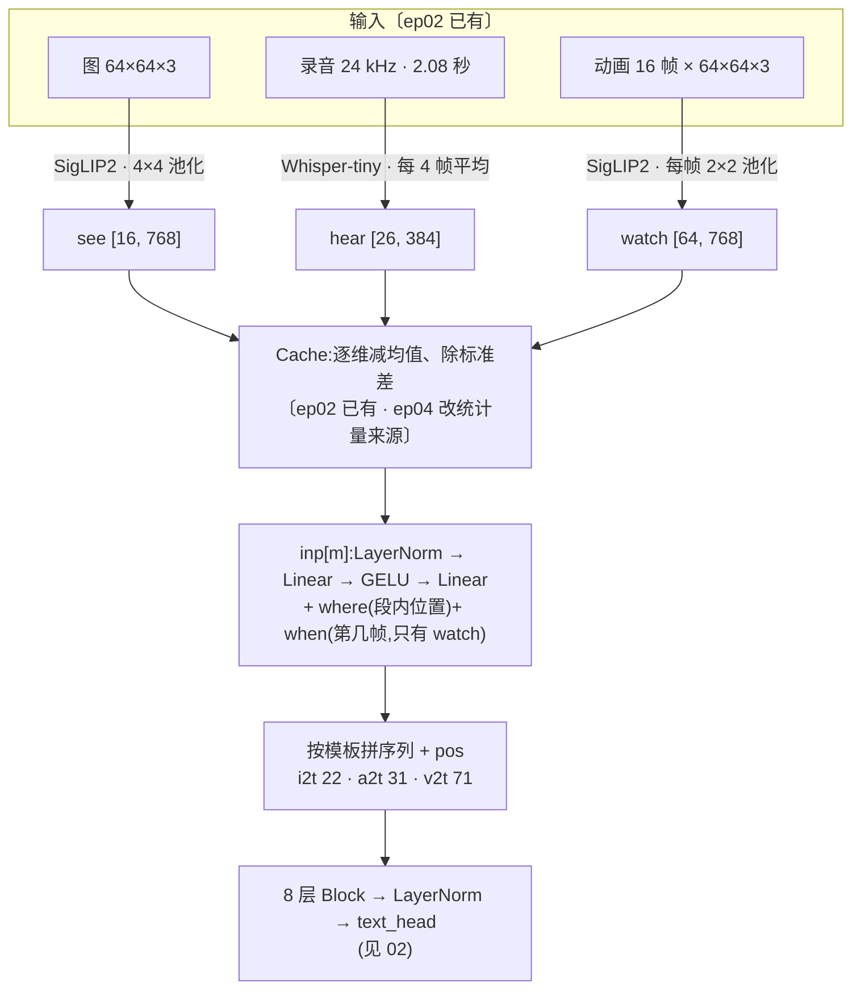

# 01 · 从输入到标签:一道理解题的一生

本篇跟着三道题各走一遍:一张「红色 小猫」的图、一条念「小猫」的录音、一段「红色 小猫 向左跑」的动画。冻结的 SigLIP2 和 Whisper 先把它们变成一串向量,归一化后经过两层小投影进入主干,和几个文字记号排成一条序列;主干在答案位上为 27 项打分,选出颜色、动物、动作。打分和解码在 [02](02-文字出口与词表.md) 里讲,本篇只讲答案位之前的部分。

每节标题后面标了出处:

- **〔ep02 已有〕**:第 2 集的代码里就有,第 2、4、5 集都没训练这一项。
- **〔ep04 新增〕**:第 4 集加的,第 4、5 集都没用上。
- **〔ep06 首次启用〕**:代码早就有,本集第一次真正跑起来。

本集代码和第 5 集(也和第 4 集的同名文件)逐字节相同,所以下面的行号对这三集都成立。

## 0. 全链路一张图



## 1. 出题:图、录音、动画〔ep02 已有〕

理解题不另造数据,和生成题共用同一批:

| 题 | 训练集 | 测试集 | 标签 |
|---|---|---|---|
| i2t 看图 | `world_train.npz` 的 60000 张图 | `world_test.npz` 的 2000 张图(种子从 900000000 起,和训练不重叠) | 颜色、动物 |
| v2t 看视频 | 同一文件的 10000 段动画 | 500 段动画 | 颜色、动物、动作 |
| a2t 听声 | `voice.npz` 里 324 条训练录音,每条做 4 份 → 1296 行 | 108 条测试录音(README 说是训练划分里没出现的 3 个音色) | 动物 |

命令见 [README](../README.md) 第 2 节:

```bash
python data.py world "$W/data/world_test.npz" 2000 500 900000000
python data.py world "$W/data/world_train.npz" 60000 10000 0
```

图和动画由 [`world/world.py`](../code/world/world.py) 按种子画出来,出题程序同时记下颜色、动物、动作,这就是标准答案。录音沿用第 4 集合成并把关过的 `voice.npz`(下载地址和 sha256 见 README)。

理解题**不需要判卷器**:答案直接和这些标签比对(见 [04](04-理解评测推理与报告.md))。所以只用发布权重看图、听声、看视频时,不用准备 `train_judges.py` 的产物。

## 2. 看:`See`(SigLIP2)〔ep02 已有〕

[frozen.py:85-96](../code/frozen.py#L85)

```python
class See:
    def encode(self, u8, grid):                     # [B, 64, 64, 3] -> [B, grid*grid, 768]
        x = F.interpolate(u8_to_pm1(u8), size=224, mode="bicubic", align_corners=False)   # SigLIP 的归一化正是 [-1,1]
        h = self.m(pixel_values=x).last_hidden_state                                     # [B, 196, 768]
        B = h.shape[0]
        h = h.transpose(1, 2).reshape(B, -1, 14, 14)
        return F.adaptive_avg_pool2d(h, grid).flatten(2).transpose(1, 2)
```

- 用的是 `google/siglip2-base-patch16-224` 的**视觉塔**([frozen.py:20](../code/frozen.py#L20)),冻结、不更新。
- 64×64 的图先双三次放大到 224×224,切成 14×14 = 196 个块,每块输出一个 768 维向量。
- 再把 14×14 的网格平均池化成 `grid × grid`:看图 `grid=4` 得 16 个向量,看视频每帧 `grid=2` 得 4 个向量。

[encode.py:108-118](../code/encode.py#L108) 把训练、测试两份都编好:

```python
def see(m):
    out = {f"{s}.img_see": half(run(m.encode, d["img"], 512, grid=4)) for s, d in (("train", tr), ("test", te))}

def watch(m):
    for s, d in (("train", tr), ("test", te)):
        v = d["vid"]
        f = run(m.encode, v.reshape(-1, 64, 64, 3), 512, grid=2)
        out[f"{s}.vid_see"] = half(f.view(len(v), -1, f.shape[-1]))                  # 16 帧 x 4 = 64 个
```

看视频没有专门的视频编码器,而是**把 16 帧当 16 张图**各过一遍 SigLIP2,按帧顺序排成 `[64, 768]`:前 4 个是第 0 帧,接着 4 个是第 1 帧,以此类推。动作信息(向左跑、跳……)只能靠主干比较前后帧得出。

> **注意 · 理解和生成用两套编码器**:看图用 SigLIP2,画图用 FLUX.2 VAE;听声用 Whisper,念名字用 Mimi;看视频用逐帧 SigLIP2,演动画用 Wan VAE。[sparrow.py:6-7](../code/sparrow.py#L6) 的说明写的是「和 Janus、BAGEL、Qwen-Omni 一样」。要比较「理解能不能直接用生成那一侧的潜变量」,有 `--see_from img` 开关(见 [05](05-本集未用到的开关.md))。

## 3. 听:`Hear`(Whisper-tiny 编码器)〔ep02 已有〕

[frozen.py:99-111](../code/frozen.py#L99)

```python
class Hear:
    def encode(self, wav):                          # [B, CLIP] @24k -> [B, 26, 384]
        w16 = [librosa.resample(w, orig_sr=SR, target_sr=16000) for w in wav.float().cpu().numpy()]
        feats = self.fx(w16, sampling_rate=16000, return_tensors="pt").input_features.to(dev)
        h = self.m(feats).last_hidden_state[:, :AUD_FRAMES * 4]      # Whisper 每 20ms 一帧,2.08 秒 = 104 帧
        return F.avg_pool1d(h.transpose(1, 2), 4).transpose(1, 2)    # 每 4 帧平均(80ms)-> 26 个,和 Mimi 对齐
```

- 只用 `openai/whisper-tiny` 的**编码器**,不用它的解码器,所以不会「转写文字」,只给出声音特征。
- 录音先从 24 kHz 重采样到 16 kHz,Whisper 编码器每 20 ms 出一帧;只留前 104 帧(2.08 秒),每 4 帧平均成 1 个,得到 26 个 384 维向量,正好和 Mimi 的 26 帧(每帧 80 ms)对齐。

训练录音的增广和 `aud` 零件共用 `train_wavs`([encode.py:30-37](../code/encode.py#L30)):每条训练录音做 4 份,原样 1 份,另 3 份随机往后挪 0~100 ms(只挪进尾部静音,不截字);测试录音只 1 份,接在最后。所以 `hear.npz` 里是 324 × 4 + 108 = 1404 行。这个函数第 2 集就有,当时是 `main` 里的内部函数 `wav()`,第 4 集把它提了出来,内容没变。

## 4. 排成向量与归一化〔ep02 已有 · ep04 改统计量来源〕

`MODS` 登记了三种理解模态的形状([sparrow.py:45-47](../code/sparrow.py#L45)):

```python
# 模态:(每个向量几维, 每帧几个向量, 几帧, 是生成用的潜变量吗)
MODS = {..., "see": (768, 16, 1, False), "watch": (768, 4, 16, False), "hear": (384, AUD_FRAMES, 1, False)}
```

第四项 `False` 表示「不是生成用的」:没有 `flow_head`,不加噪,也不加噪声时间嵌入。`watch` 写成「每帧 4 个、16 帧」,所以它有 `when`(时间位置)参数;`configure` 还会按 `--watch_frames` 改它的帧数([sparrow.py:84](../code/sparrow.py#L84),本集是默认的 16)。

缓存里的字段名由 `FIELD` 对照([sparrow.py:331-333](../code/sparrow.py#L331)):`see → img_see`、`watch → vid_see`、`hear → aud_hear`。理解特征在缓存里本来就是 `[N, 向量数, 维度]`,`tokens` 原样返回,不用像潜变量那样重排。

归一化在 `Cache` 里做:每种模态逐维算训练集的均值和标准差,再 `(x - 均值) / 标准差`([sparrow.py:336-338](../code/sparrow.py#L336))。统计量的长度就是向量维度:`see`、`watch` 各 768 维,`hear` 384 维。本集这三种是**现算**的,图、声音、视频的则沿用第 5 集,规则见 [03](03-六任务接续训练.md) 第 1 节。

## 5. 进主干:两层投影 + 位置〔ep02 已有〕

[sparrow.py:258-265](../code/sparrow.py#L258)

```python
# 进主干:生成潜变量用一层线性;理解编码器的输出用两层小投影(LLaVA 式)
self.inp = nn.ModuleDict({m: make(f"inp.{m}", lambda d=d, g=g: nn.Linear(d, dim) if g else
                                  nn.Sequential(nn.LayerNorm(d), nn.Linear(d, dim), nn.GELU(), nn.Linear(dim, dim)))
                          for m, (d, n, f, g) in MODS.items()})
self.where = nn.ParameterDict({...})       # 段内位置:每种模态 n 个
self.when = nn.ParameterDict({...})        # 时间位置:只给 f > 1 的模态
```

`embed`([sparrow.py:274-281](../code/sparrow.py#L274))把一段特征变成主干的输入:

```python
h = self.inp[mod](x)
pos = self.where[mod].repeat(f, 1)                                     # 帧内位置
if f > 1:
    pos = pos + self.when[mod].repeat_interleave(n, 0)                 # 时间位置:第几帧
h = h + pos
return h + self.temb(sinus(t))[:, None] if g else h                    # 理解特征不加噪声时间
```

三种理解模态的可训练部件:

| 模态 | `inp`(LN + 两层 Linear) | `where` | `when` |
|---|---:|---:|---:|
| `see` | 444,672 | 16 × 384 = 6,144 | — |
| `watch` | 444,672 | 4 × 384 = 1,536 | 16 × 384 = 6,144 |
| `hear` | 296,448 | 26 × 384 = 9,984 | — |

对比生成那一侧:`inp.img` 只是一层 `Linear(32, 384)`。理解特征维度高(768 / 384)、分布和主干差得远,所以多一层 LayerNorm 和一层 MLP,这是 LLaVA 的做法。

`watch` 的位置是两部分相加:`where.watch` 表示「这是一帧里的第几个(2×2 的哪一格)」,`when.watch` 表示「这是第几帧」。缓存按帧排好,所以 `repeat` 和 `repeat_interleave` 刚好对上。

> **注意 · 这些部件从第 2 集起就在权重里**:`Sparrow` 不管练哪几项,都按 `MODS` 把全部模态的部件建出来,所以第 2、4、5、6 集的参数量都是 16.04M,权重里都是 128 个张量。理解部件此前没收到过梯度,本集才第一次被训练。证据见 [02](02-文字出口与词表.md) 第 5 节。

## 6. 拼成序列〔ep02 已有 · ep06 首次启用〕

三条模板([sparrow.py:55-57](../code/sparrow.py#L55)):

```python
"i2t": ["<bos>", "", ("see", False), "</img>", "C*", "A*", "<eos>*"],
"a2t": ["<bos>", "<aud>", ("hear", False), "</aud>", "A*", "<eos>*"],
"v2t": ["<bos>", "<vid>", ("watch", False), "</vid>", "C*", "A*", "T*", "<eos>*"],
```

`Layout`([sparrow.py:142-180](../code/sparrow.py#L142))按模板逐项展开,算出每个位置是什么。以 i2t 为例:

| 位置 | 0 | 1 | 2 ~ 17 | 18 | 19 | 20 | 21 |
|---|---|---|---|---|---|---|---|
| 内容 | `<bos>` | `` | `see` 16 个 | `</img>` | 颜色* | 动物* | `<eos>`* |

三条序列的长度(和 `report.json` 的 `seq_len` 一致):

| 任务 | 长度 | 组成 |
|---|---:|---|
| i2t | 22 | 3 个记号 + 16 个特征 + 3 个答案 |
| a2t | 31 | 3 个记号 + 26 个特征 + 2 个答案 |
| v2t | 71 | 3 个记号 + 64 个特征 + 4 个答案 |

都远小于默认的 `maxlen=400`,和 t2v 的 325 比也短得多,所以理解题每步算得很快(训练耗时的变化见 [03](03-六任务接续训练.md))。

几点和生成模板不同的地方:

- **开、闭两个标签**:` … </img>`。生成模板只有开标签,后面直接跟到序列末尾;理解模板的特征后面还要接答案,所以用闭标签告诉主干「特征到这里结束,该回答了」。`</img>`、`</aud>`、`</vid>` 三个记号只在理解模板里出现。
- **同一个 `` 后面跟的东西不同**:t2i 里跟 FLUX.2 潜变量,i2t 里跟 SigLIP2 特征。主干靠后面向量的位置参数(`where.img` 对 `where.see`)和闭标签区分。
- **答案位带 `*`**:颜色、动物、动作、`<eos>` 都是要预测的格子。`Layout` 把它们的位置记进 `self.answer`,训练时只在这些格子上算损失。

`forward`([sparrow.py:283-300](../code/sparrow.py#L283))把文字段(`tok` 嵌入)和模态段(`embed`)按顺序拼起来,加上整条序列的位置嵌入 `pos`,过 8 层 `Block`,最后 `norm` 后接 `text_head`。理解题没有加噪段(`lay` 没有 `noisy` 属性),所以 `flow_head` 不参与,只返回文字出口的 logits。

## 7. 训练时取一批〔ep02 已有 · ep04 改用 `data.key`〕

[sparrow.py:460-474](../code/sparrow.py#L460) 里,理解题和对应的生成题共用一个分支,只是取的特征不同:

```python
if task in ("t2i", "i2t"):
    i = self.img[r(len(self.img))]                                         # 随机抽训练图
    return ({"C": 颜色词, "A": 动物词}, [pick(tr[key[mods[0]]], i)])        # i2t 时 mods[0] = "see"
if task in ("t2v", "v2t"):
    ...                                                                     # 多一个 "T": 动作词
i = self.vtr[r(len(self.vtr))]                                             # 听声:随机抽训练录音行
return {"A": ANIMAL_ID.to(dev)[a]}, [pick(v[key[mods[0]]], i)]
```

返回的词槽(`C`/`A`/`T`)对生成题是「条件」,对理解题就是「标准答案」:`fill_tok` 把它们填进答案位(见 [02](02-文字出口与词表.md) 第 3 节)。

第 2 集写的是 `FIELD["img" if task == "t2i" else "see"]`([ep02 sparrow.py:263](../../ep02-t2i/code/sparrow.py#L263)),第 4 集改成从模板取模态名、再查 `self.key`,这样 `--see_from img` 时 i2t 能自动改读 FLUX.2 潜变量那份缓存。本集用默认设置,两种写法取到的是同一份数据。
