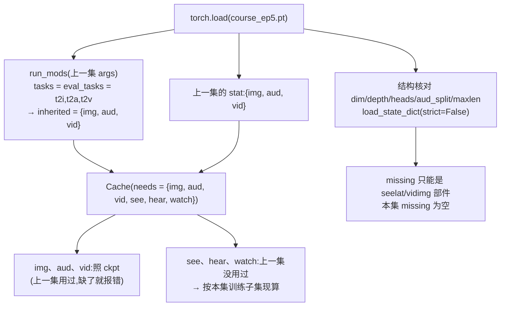

# 03 · 六任务接续训练:接第 5 集,三新三旧一起练

本集主线命令([README](../README.md) 第 2 节):

```bash
python encode.py --data "$W/data" --judges "$W/judges" \
  --out "$W/cache" --parts img,aud,vid,see,hear,watch

python sparrow.py --data "$W/data" --cache "$W/cache" --judges "$W/judges" \
  --out "$W/runs/course_ep6" --init "$INIT" \
  --tasks t2i,t2a,t2v,i2t,a2t,v2t --steps 4000 \
  --seed 0 --rng legacy --vid_attn full --eval_every 0
```

和第 5 集主线(`--tasks t2i,t2a,t2v --steps 4000`)相比,只是 `--tasks` 多了 `i2t,a2t,v2t`,`encode.py` 多编了 `see,hear,watch` 三个零件。其余参数(步数、批量、学习率、`--vid_attn full`、`--rng legacy`)都和第 5 集一样。这条命令背后用到的「接着练」机制是第 4 集写好的(见 [ep04 docs/02](../../ep04-t2a/docs/02-接续训练与旧题回放.md)),第 5 集第一次用它加进一个生成模态(见 [ep05 docs/03](../../ep05-t2v/docs/03-三任务接续训练.md));本篇只讲**一次加进三个理解模态**时,它们各自怎么处理。

若第 5 集的数据、判卷器和缓存已经齐全,只需补 `encode.py --parts see,hear,watch`。`encode.py` 按零件分文件存(`see.npz`、`hear.npz`、`watch.npz`),`encode.json` 也是合并写入,不会覆盖已有零件。

## 1. `--init`:哪些照搬、哪些现算〔ep04 新增 · ep06 首次加理解模态〕

[sparrow.py:1102-1121](../code/sparrow.py#L1102) 的流程:



三件事分开说:

**① 归一化统计量**。`Cache` 逐个模态决定来源([sparrow.py:405-433](../code/sparrow.py#L405))。三种理解模态都是「本集新加的」,按各自的训练数据现算,来源说明由字段名决定:

| 模态 | 字段 | 现算用的数据 | 按当前代码写出的来源说明 |
|---|---|---|---|
| `see` | `img_see` | 训练图 60000 张 | `现算:训练图 60000 张(本集新加的模态)` |
| `watch` | `vid_see` | 训练动画 10000 段 | `现算:训练动画 10000 段(本集新加的模态)` |
| `hear` | `aud_hear` | 训练录音 1296 行(324 条 × 4 份) | `现算:训练录音 1296 行(本集新加的模态)` |

训练结束后 `save` 把六组统计量一起存进 `final.pt`([sparrow.py:575-577](../code/sparrow.py#L575))。[`PROVENANCE.json`](../PROVENANCE.json) 的 `ep6_source_vs_package.stat_tensors` 是 12,正好是 6 个模态 × (均值、标准差)。

用标准库解析两份发布权重(不依赖 torch)核对:第 6 集 `final.pt` 里 `img`、`aud`、`vid` 的 6 个统计量张量与第 5 集 `final.pt` **逐字节相同**;`see`、`watch` 是 768 维,`hear` 是 384 维,都是新加的。

> **注意 · 报告里查不到统计量来源**:主线的 `report.json` 是较早版本的代码写的(见第 5 节),没有 `stat_source` 字段。第 2 集那版 `Cache` 每次都按训练集重算全部统计量([ep02 sparrow.py:234-246](../../ep02-t2i/code/sparrow.py#L234)),不沿用。只要训练数据和缓存与上一集相同,重算的值和沿用的值一样,所以上面「逐字节相同」分不出是哪一种;能确定的是,结果和第 5 集一致。

**② 模型参数**。第 5 集的权重里本来就有全部理解部件(`inp.see/watch/hear`、`where.see/watch/hear`、`when.watch`、`text_head`,见 [01](01-从输入到标签全链路.md) 第 5 节),所以 `load_state_dict(strict=False)` 不缺也不多,全部照搬。这些部件此前从没训练过(证据见 [02](02-文字出口与词表.md) 第 5 节),本集才第一次收到梯度。[`PROVENANCE.json`](../PROVENANCE.json) 的 `ep5_actual_init_vs_public` 核验了本次训练实际的起点和公开的第 5 集参数:128 个模型张量、6 个统计量张量完全一致。

**③ 结构核对**。`dim/depth/heads/aud_split/maxlen` 必须和上一集一致,否则退出([sparrow.py:1115-1117](../code/sparrow.py#L1115))。理解序列最长 71,默认 `maxlen=400` 放得下。

## 2. 每步怎么配六种题〔ep02 已有 · ep04 抽成函数〕

`train`([sparrow.py:517-572](../code/sparrow.py#L517))每一步按 `--tasks` 的顺序 t2i → t2a → t2v → i2t → a2t → v2t,每种题各取一批、各自前向、各自 `backward`,梯度累加起来,最后只做一次裁剪(范数 1.0)和一次 `opt.step()`。生成题走 `if task in GEN` 分支(流匹配 MSE),理解题走 `else` 分支(交叉熵,见 [02](02-文字出口与词表.md) 第 3 节)。

每种题取多少条由 `batch` 决定([sparrow.py:489-491](../code/sparrow.py#L489)):视频两样(`t2v`、`v2t`)用 `--bs_vid`,其余用 `--bs`。本集没写 `--bs_task`,所以:

| 任务 | 每步条数 | 损失权重 | 4000 步共见过 | 训练集大小 | 平均每条见过 |
|---|---:|---:|---:|---:|---:|
| t2i | 512 | 1 | 2,048,000 | 60,000 张图 | 约 34 次 |
| t2a | 512 | 4(`--weights t2a=4`,默认) | 2,048,000 | 1,296 行录音 | 约 1580 次 |
| t2v | 128 | 1 | 512,000 | 10,000 段动画 | 约 51 次 |
| **i2t** | 512 | 1 | 2,048,000 | 60,000 张图 | 约 34 次 |
| **a2t** | 512 | 1 | 2,048,000 | 1,296 行录音 | 约 1580 次 |
| **v2t** | 128 | 1 | 512,000 | 10,000 段动画 | 约 51 次 |

主线报告由旧版代码写出,没有 `batch_per_step`、`exposure` 字段;上表按 `args` 里的 `bs`、`bs_vid`、`steps`、`weights` 和 [`batch`](../code/sparrow.py#L489) 的规则算出。

几点说明:

- **旧题回放就是照常练满**:旧题每步仍是 512 / 512 / 128 条,没有单独调比例。
- **理解题和生成题抽同一批数据,但各抽各的**:i2t 和 t2i 都从训练图里随机抽,只是同一步里两次抽样互相独立。
- **权重 4 只给 t2a**:`--weights` 默认 `t2a=4`,a2t 是 1。
- **随机协议是 `legacy`**:全部随机数按顺序从全局 RNG 里取。多加三种题后,旧题每一步抽到的样本也和第 5 集不同,所以第 5、6 集的旧题成绩不是成对对照,只是两次运行的记录。两种协议的区别见 [ep04 docs/03](../../ep04-t2a/docs/03-随机协议与可复现.md)。

学习率和第 5 集相同:前 300 步线性升到 6e-4,之后按余弦降到 0.1 倍;EMA 0.999,训练结束时用 EMA 权重存盘([sparrow.py:524](../code/sparrow.py#L524)、[554-571](../code/sparrow.py#L554))。

## 3. 训练耗时与显存

| | 第 5 集主线 | 第 6 集主线 |
|---|---:|---:|
| 每步的题 | 3 种 | 6 种 |
| 训练耗时 | 1074.2 秒 | 1474.8 秒 |
| 每 100 步约 | 26.9 秒 | 36.9 秒 |
| 训练张量显存峰值 | 7.06 GB | 7.07 GB |

出处:两集的 `weights/*/report.json`(`train_seconds`、`train_peak_mem_GB`、`log`)。

多出三种题,训练时间多了约 400 秒(约 37%),显存峰值却几乎不变。这是因为每种题前向后马上 `backward`,中间激活随即释放,显存峰值由最大的那一种题决定;那仍是 t2v(128 条 × 325 个位置)。理解序列只有 22 / 31 / 71 个位置,加进来只增加时间,不抬高峰值。

## 4. 训练日志 `train.jsonl`

[`reports/train.jsonl`](../reports/train.jsonl) 是主线的 40 条日志,和 `report.json` 的 `log` 逐条相同。每 100 步写一条([sparrow.py:549-559](../code/sparrow.py#L549)):

```json
{"step": 0, "sec": 1.4, "t2i": 0.2715, "t2a": 0.221, "t2v": 0.1045, "i2t": 3.6372, "a2t": 3.7081, "v2t": 3.2927}
```

- `step`:第几步(从 0 起);`sec`:到这一步为止的训练秒数。
- 六个任务名:**这一步那一批**的损失,四舍五入到小数点后 4 位,是乘权重之前的值。只有一批,所以抖动不小,看趋势要多看几个点。

摘几个点:

| step | i2t | a2t | v2t | t2i | t2a | t2v |
|---:|---:|---:|---:|---:|---:|---:|
| 0 | 3.6372 | 3.7081 | 3.2927 | 0.2715 | 0.2210 | 0.1045 |
| 100 | 0.0003 | 0.0001 | 0.0016 | 0.2919 | 0.2303 | 0.0864 |
| 200 | 0.0001 | 0.0001 | 0.0002 | 0.3097 | 0.2291 | 0.1031 |
| 600 | 0.0 | 0.0 | 0.0 | 0.3195 | 0.2428 | 0.0962 |
| 1100 | 0.0001 | 0.0 | 0.0049 | 0.3160 | 0.2588 | 0.1030 |
| 2000 | 0.0 | 0.0 | 0.0 | 0.2868 | 0.2250 | 0.0759 |
| 3900 | 0.0 | 0.0 | 0.0 | 0.2868 | 0.2006 | 0.0626 |

能读出的几点:

- **理解题学得极快**:第 0 步接近 27 项均匀猜的 ln 27 ≈ 3.2958(原因见 [02](02-文字出口与词表.md) 第 5 节);100 步内降到 0.002 以下;从第 600 步起,除了第 1100 步的一次小抖动(v2t 0.0049),四位小数下都是 0.0。这批数据是程序画的,标签没有噪声,颜色 × 动物(× 动作)的组合也是固定的几十种,这可能是学得这么快的原因;本集没有做对照来验证。
- **生成题前几百步损失上升,然后回落**:t2i 从 0.2715 升到第 600 步的 0.3195,之后逐渐回落,最后 10 条的平均值 0.2786 与第 5 集最后 10 条的 0.2789 相当。前几百步正好是学习率预热到峰值的阶段,而新加的三种题在此时梯度最大;不过这只是单批损失,本集没有做对照(例如不加理解题、只续训旧题)来确认原因。
- **t2a、t2v 的损失比第 5 集末尾还低**:最后 10 条平均,t2a 0.2018 对第 5 集的 0.2260,t2v 0.0758 对 0.0904。这是多练了 4000 轮的结果,但损失低不等于成绩高:t2a 的终评正确率反而从 97.9% 降到 96.7%(见 [04](04-理解评测推理与报告.md) 第 3 节)。

## 5. 主线报告由哪个版本的代码写出

`report.json` 和 `final.pt` 里存的 `args` 只有这些键:

```
data cache judges out tasks eval_tasks init steps dim depth heads bs bs_vid lr ema cfg
aud_split vid_attn weights eval_every eval_only
```

这和第 2 集 `sparrow.py` 的命令行参数([ep02 sparrow.py:540-561](../../ep02-t2i/code/sparrow.py#L540))**完全一致**,没有当前代码的 `seed`、`rng`、`maxlen`、`watch_frames`、`see_from`、`bs_task` 等;报告里也没有 `init`、`stat_source`、`eval_config`、`batch_per_step`,t2i 的最近邻是旧字段 `nn_dist_gen_mean` / `nn_dist_test_mean`,a2t 没有 `by_voice`。这些都说明报告是第 2 集那一版的写法。第 5 集主线报告也是这样(见 [ep05 docs/README](../../ep05-t2v/docs/README.md) 的「本集的实测数字」)。

和 README 命令的对照:

| README 命令里的参数 | 旧版代码 | 是否等价 |
|---|---|---|
| `--seed 0` | 没有这个参数,`main` 里写死 `torch.manual_seed(0)` | 等价 |
| `--rng legacy` | 没有这个参数,只有全局随机数 | 等价:当前代码的 `legacy` 就是照旧版的取法 |
| `--vid_attn full`、`--eval_every 0` | 有 | 相同 |
| 统计量继承 | 旧版每次重算 | 本集结果相同(见第 1 节) |
| 生成题评测噪声 | 旧版用全局种子 1234 | **不同**:当前代码按题号定噪声 |

所以 README 第 2 节说:用所附代码重新评测生成题,不保证得到相同分数或逐字节相同的样例。理解题不受影响,原因见 [04](04-理解评测推理与报告.md) 第 1 节。

当前代码读这份权重时,`with_defaults` 会给缺的键补上默认值(`watch_frames=16`、`see_from="see"`、`maxlen=400`……,[sparrow.py:71-77](../code/sparrow.py#L71));`--eval_only` 时 `rng` 和 `seed` 分别按 `legacy` 和 0 处理([sparrow.py:1090](../code/sparrow.py#L1090))。这些默认值和本集实际的设置一致,所以 `infer.py`、`--eval_only` 都能直接用这份权重。
