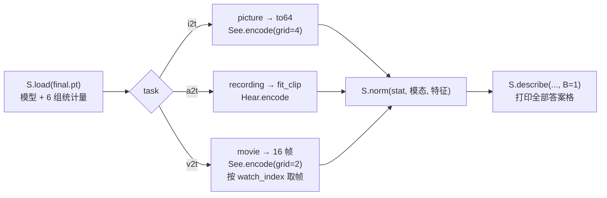

# 04 · 理解评测、推理与报告:怎么判、数字怎么读、怎么自己用

本篇讲训练完以后:evaluate 怎么出题、怎么判理解三题;零轮基线和训练后的成绩;旧题有没有退步;`infer.py` 怎么处理一张图、一条录音、一段动画;以及 `samples/lesson/answers.json`、`PROVENANCE.json` 记了什么。

## 1. 出题与判分〔ep02 已有 · ep04 加 `by_voice`〕

三段代码在 [sparrow.py:917-945](../code/sparrow.py#L917)。和生成题不同,理解题**不用判卷器**:模型说出的编号直接和出题程序记下的标签比对。

| 段 | 题数 | 输入 | 判对的口径 | 报告字段 |
|---|---:|---|---|---|
| 4a 看图 i2t | 2000 | `world_test.npz` 全部测试图的 `see` 特征 | 第 1 格 = 颜色、第 2 格 = 动物 | `color_acc`、`animal_acc`、`both_acc` |
| 4b 听声 a2t | 108 | 全部测试录音的 `hear` 特征 | 第 1 格 = 动物 | `animal_acc`(当前代码另有 `by_voice`) |
| 4c 看视频 v2t | 500 | 全部测试动画的 `watch` 特征 | 第 1~3 格 = 颜色、动物、动作 | `color_acc`、`animal_acc`、`action_acc`、`all_acc` |

以 i2t 为例([sparrow.py:917-924](../code/sparrow.py#L917)):

```python
n = len(te["img_animal"])
field = data.key[...]                     # SigLIP2 特征,或 --see_from img 时 FLUX.2 潜变量
ans = torch.cat([describe(model, lays, "i2t", [te[field][s:e].to(dev)], e - s) for s, e in chunks(n, 500)])
c_ok, a_ok = ans[:, 0] == ids(COLOR_ID, te["img_color"]), ans[:, 1] == ids(ANIMAL_ID, te["img_animal"])
rep["i2t"] = {"n": n, "color_acc": acc(c_ok), "animal_acc": acc(a_ok), "both_acc": acc(c_ok & a_ok)}
```

几点说明:

- **只看内容格,不看 `<eos>` 格**:`ans[:, 0]`、`ans[:, 1]` 是颜色和动物,最后一格 `<eos>` 不参与判分。README 说「按整题检查内容标签,不检查结束标签」就是这个意思。
- **整题对**:i2t 的 `both_acc`、v2t 的 `all_acc` 要求每个内容格都对。a2t 只有一个内容格,`animal_acc` 就是整题对。
- **不用噪声**:`describe` 每一格取分数最高的那项,同一份权重、同一份特征,回答是确定的(bf16 运算的细微差别除外)。所以第 2 集那版的「全局种子 1234」和当前代码的「按题号定噪声」只影响生成题,不影响这三项。
- **听声的测试录音来自没听过的音色**:README 说 108 条测试录音来自训练划分里没出现的 3 个音色。第 2 集代码在这一段的注释写的是「没听过的 4 个音色」([ep02 sparrow.py:509](../../ep02-t2i/code/sparrow.py#L509)),第 4 集改成了「没听过的音色」,不写个数。本集以 README 为准。
- **`by_voice`**:当前代码按测试音色分别报正确率([sparrow.py:929-932](../code/sparrow.py#L929)),能看出是否某个音色特别难。主线报告是旧版代码写的,没有这个字段。

每段还导出几个样例,文件名就是模型说的话(`word` 去掉斜杠,[sparrow.py:812](../code/sparrow.py#L812)):

| 样例 | 取哪几道 | 本集主线的实际文件 |
|---|---|---|
| `i2t_{k}_模型说{颜色}{动物}.png` | 测试图第 0~4 张,放大 4 倍 | `i2t_0_模型说绿色小鸟.png` 等 5 张 |
| `a2t_{k}_模型说{动物}.wav` | 测试录音均匀取 5 条,原录音 | `a2t_0_模型说小兔.wav` 等 5 条 |
| `v2t_{k}_模型说{颜色}{动物}{动作}.gif` | 测试动画第 0~2 段,放大 3 倍 | `v2t_0_模型说红色小狗转身.gif` 等 3 段 |

这些文件是**输入**(测试图、测试录音、测试动画),文件名记的是模型的回答。`samples/course_ep6/` 里以 `gen_` 开头的才是生成题的输出。

## 2. 零轮基线:`before_training.json`〔ep06 新增〕

[`reports/before_training.json`](../reports/before_training.json) 记的是「第 5 集参数不训练,直接考理解题」。它的 `args` 是 `--init init/course_ep5.pt --tasks i2t,a2t,v2t --steps 0`:`train` 的循环一次都不跑,直接存盘、评测。三种理解特征的统计量按本集训练数据现算,模型参数就是第 5 集的。

| 任务 | 字段 | 零轮 | 4000 轮后 |
|---|---|---:|---:|
| i2t(2000 题) | `color_acc` | 0.057 | 1.0 |
| | `animal_acc` | 0.007 | 1.0 |
| | `both_acc` | **0.0** | **1.0**(2000/2000) |
| a2t(108 题) | `animal_acc` | **0.0** | **1.0**(108/108) |
| v2t(500 题) | `color_acc` | 0.022 | 1.0 |
| | `animal_acc` | 0.07 | 1.0 |
| | `action_acc` | 0.008 | 1.0 |
| | `all_acc` | **0.0** | **1.0**(500/500) |

出处:`before_training.json` 和 [`weights/course_ep6/report.json`](../weights/course_ep6/report.json) 的 `eval`。

读这张表要注意:

- **整题 0% 不等于每格都错**:i2t 的颜色格蒙对了 5.7%,v2t 的动物格蒙对了 7%。只是没有一道题的全部内容格同时对。
- **零轮的回答不一定是标签**:没训过的 `text_head` 对 27 项都可能给高分,答案格里出现 `<vid>`、`</img>` 这类记号很常见(见 [02](02-文字出口与词表.md) 第 4 节的实例)。所以零轮的单格正确率可以低于「在该类标签里瞎猜」的 1/8、1/6、1/4。
- **100% 只说明这批测试题全对**:测试图、动画和训练集由同一个程序按不同种子画出,颜色、动物、动作的组合也都在训练里出现过;听声的测试音色虽然没听过,念的仍是那 6 个词。README 也说「100% 也不等于任意现实输入都能理解」。

零轮评测只用了 1.2 秒(`eval_seconds`),显存峰值 0.51 GB:理解题不用加载 VAE、Mimi、Paraformer,也不跑多步生成。

## 3. 旧题成绩:学会理解之后,生成退步了没有

| 任务 | 第 5 集主线 | 第 6 集主线 | 变化 |
|---|---|---|---|
| t2i 画图 `both_acc` | 1.0(384/384) | 1.0(384/384) | 相同 |
| t2a 念名字 `sound_acc` | 0.9792(235/240) | 0.9667(232/240) | 多错 3 条 |
| t2v 演动画 `all_acc` | 0.9948(191/192) | 0.9948(191/192) | 相同 |

出处:两集的 `weights/*/report.json`。

第 6 集 t2a 的 `sound_by_word`:小猫 1.0、小狗 0.95、小兔 0.925、小鸟 0.925、小鱼 1.0、小熊 1.0;`misheard` 里记了 8 条听错的结果,例如「小狗小」「小兔儿」「小偷儿」。第 5 集的主线报告没有 `sound_by_word`,不能逐词对比。

t2i 的旧字段 `nn_dist_gen_mean`(生成图到最近训练图的平均距离)从第 5 集的 2769.44 变为 2726.50,`nn_dist_test_mean` 都是 2196.86。这个旧字段只取前 128 张,口径和当前代码的 `nearest` 不同,详见 [ep04 docs/04](../../ep04-t2a/docs/04-评测与推理的变化.md)。

> **注意 · 这是两次单独运行,不是成对对照**:第 5、6 集都用 `legacy` 随机协议,第 6 集多了三种题,旧题每步抽到的样本、评测时的全局随机数都和第 5 集不同。t2a 多错 3 条(240 条里差 1.25 个百分点),不能据此断言「学理解让念名字变差」;要下这个结论,需要用 `--rng paired` 做「加不加理解题」的成对对照,并重复几个种子。

## 4. 自己用:`infer.py` 的三种理解输入〔ep02 已有 · ep04 扩充〕

```bash
python infer.py ../weights/course_ep6/final.pt i2t ../samples/lesson/frame0.png
python infer.py ../weights/course_ep6/final.pt a2t ../samples/lesson/voice_cat.wav
python infer.py ../weights/course_ep6/final.pt v2t ../samples/lesson/anim.gif
```

理解题只需要权重和对应的冻结编码器(SigLIP2 或 Whisper),不需要数据缓存、判卷器,也不需要 VAE、Mimi。流程([infer.py:83-121](../code/infer.py#L83)):



各种输入的预处理:

| 任务 | 函数 | 做了什么 | 出处 |
|---|---|---|---|
| i2t | `picture` → `to64` | 转 RGB 后缩到 64×64:如果是正方形、边长是 64 的整数倍(本仓库导出的放大图),用最近邻缩回,逐像素还原;否则双线性 | [infer.py:32-40](../code/infer.py#L32),ep04 新增最近邻分支;ep02 一律双线性 |
| a2t | `recording` → `fit_clip` | 按 24 kHz 读入;去首尾静音(`top_db=40`),音量归一到 0.9,前留 50 ms,尾部补静音到 2.08 秒;去静音后放不下就报错,绝不截字 | [infer.py:56-61](../code/infer.py#L56)、[parts.py:88-97](../code/parts.py#L88),ep02 已有 |
| v2t | `movie` | 接受 `.gif`、16 帧的 `.npy`、或放 16 张 png 的目录;每帧过 `to64`;帧数不是 16 就报错 | [infer.py:43-53](../code/infer.py#L43),ep04 新增;ep02 只读 gif 且静默截前 16 帧 |
| v2t | 取帧 | `See.encode(grid=2)` 得 `[16, 4, 768]`,再按这份权重的 `watch_frames` 用 `watch_index` 取帧 | [infer.py:110-113](../code/infer.py#L110),ep04 新增 |

编码时用 `torch.autocast("cuda", torch.bfloat16)`,和 `encode.py` 编缓存时同一精度([infer.py:105](../code/infer.py#L105))。编完用这份权重里存的统计量归一化([infer.py:116](../code/infer.py#L116)),再交给 `describe`。输出是全部答案格,用空格隔开,包括最后的 `<eos>` 格。

课堂样例刚好覆盖了这几条路径:`frame0.png` 是 64×64 的原尺寸图;`anim.gif` 是 192×192 的 16 帧 gif(64 的 3 倍,`to64` 走最近邻);`voice_cat.wav` 是 24 kHz 单声道、2.08 秒。

### `--stat_from`:借另一份权重的统计量〔ep04 新增〕

`final.pt` 只存了训练或评测时用到的那几种统计量。第 5 集的权重里只有 `img`、`aud`、`vid`,直接跑 `v2t` 会报错:

```
这份权重没有 ['watch'] 的归一化统计量(那一集没训也没评这样本事);要用就加 --stat_from 另一份权重
```

`--stat_from` 只补缺的那几种,来源记进 `--record`([infer.py:88-95](../code/infer.py#L88)):

```python
other = {m: [...] for m, st in torch.load(a.stat_from, map_location="cpu")["stat"].items()}
filled = [m for m in mods if m not in stat and m in other]
stat.update({m: other[m] for m in filled})
rec["stat_from"] = {"ckpt": a.stat_from, "ckpt_sha256": S.sha256(a.stat_from), "mods": filled}
```

`answers.json` 里那条第 5 集权重的错答就是这样得到的:模型参数是第 5 集的,`watch` 的统计量借自第 6 集。

## 5. `samples/lesson/answers.json`〔ep06 新增〕

四条记录,字段和 `infer.py --record` 写出的一致([infer.py:86](../code/infer.py#L86)、[92](../code/infer.py#L92)、[113](../code/infer.py#L113)、[120](../code/infer.py#L120)),另加了发布时补的 `source_ckpt_sha256` 和 `input_sha256`:

| # | 权重 | 任务 | 输入 | `answer` |
|---|---|---|---|---|
| 1 | `weights/course_ep6/final.pt` | i2t | `frame0.png` | `红色 小猫 <eos>` |
| 2 | 同上 | a2t | `voice_cat.wav` | `小猫 <eos>` |
| 3 | 同上 | v2t | `anim.gif` | `红色 小猫 向左跑 <eos>` |
| 4 | `../ep05-t2v/weights/course_ep5/final.pt` | v2t | `anim.gif` | `<vid> 小兔 向右跑 跳` |

字段含义:

| 字段 | 含义 |
|---|---|
| `ckpt` / `ckpt_sha256` | 用的哪份权重、它**公开文件**的 sha256 |
| `source_ckpt_sha256` | 同一份权重在发布前(路径元数据替换前)的 sha256,对应 `PROVENANCE.json` 的映射 |
| `task`、`input`、`input_sha256` | 任务、输入文件及其 sha256;第 3、4 条是同一个 `anim.gif` |
| `out` | 理解题没有输出文件,为 `null` |
| `watch_frames` | 只在 v2t 出现:取了哪几帧,本集是 0~15 全取 |
| `stat_from` | 只在第 4 条:`watch` 统计量借自第 6 集权重 |
| `answer` | 全部答案格,含最后的 `<eos>` 格 |

第 4 条的 `ckpt_sha256` 是 `2fdfa161…`,和 README 下载第 5 集参数时核对的 sha256 相同。

`anim.gif` 是第 5 集麻雀生成的「红色 小猫 向左跑」动画,`frame0.png` 是它的第 0 帧,`voice_cat.wav` 是合成录音「小猫」。所以这三条样例都不来自 `world_test.npz`,是额外的输入。

## 6. `PROVENANCE.json`:发布时动了什么

```json
"verification": {
  "ep6_source_vs_package": {"model_tensors": 128, "stat_tensors": 12, "storages": 140, "storage_bytes": 64185516},
  "ep5_actual_init_vs_public": {"model_tensors": 128, "stat_tensors": 6, "storages": 134, "storage_bytes": 64170156},
  "ep6_path_strings_replaced": 5
}
```

- `ep6_source_vs_package`:发布的 `course_ep6/final.pt` 和训练原产物比,128 个模型张量、12 个统计量张量的存储字节完全相同。
- `ep6_path_strings_replaced: 5`:只替换了 5 个路径元数据字符串,所以文件 sha256 变了,张量没变。`PROVENANCE.json` 没写是哪 5 个;现在 `args` 里的 `data`、`cache`、`judges`、`out`、`init` 正好是 5 个路径值,都已是相对路径,很可能就是这 5 个。`answers.json` 里同时记了替换前后两个 sha256。
- `ep5_actual_init_vs_public`:本次训练实际的起点和公开下载的第 5 集参数,128 + 6 个张量一致。所以用 README 的下载命令接第 5 集训练,起点和主线相同。
- `files` 列表:每个发布文件的来源路径(`prototype/...`)和 sha256。代码文件的 `source_sha256` 与 `sha256` 相同,说明发布时代码没改。

在本集目录执行 `sha256sum -c MANIFEST.sha256` 可核对全部发布文件。
