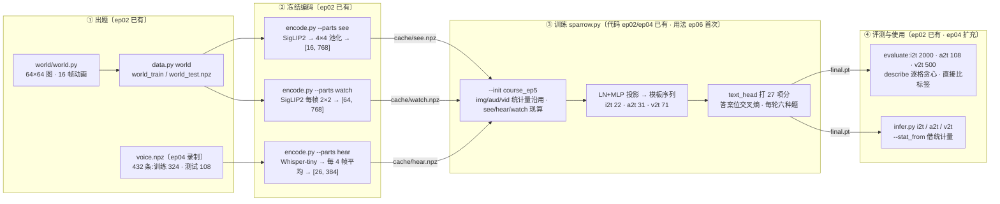

# 第 6 集代码解析:相对第 5、4、2 集多了什么

第 5 集(`ep05-t2v`)让麻雀学会演动画,画图、念名字一起练;第 6 集(`ep06-understand`)接着第 5 集的权重练 4000 轮,让同一个约 16.04M 参数的主干第一次学**「理解」**:看图说颜色和动物(`i2t`)、听声说动物(`a2t`)、看视频说颜色、动物和动作(`v2t`)。三种旧题(t2i、t2a、t2v)照练。

先说结论,免得读代码时找不到「新增」在哪:

> **第 6 集的 `code/` 和第 5 集逐字节相同(所以也和第 4 集的同名文件相同),本集没有新写一行代码。看图、听声、看视频这三条「理解」链路,第 2 集的代码里就已经全部写好了。**

- `sparrow.py`、`encode.py`、`infer.py`、`frozen.py`、`data.py`、`parts.py`、`train_judges.py`、`asr.py`、`world/world.py`、`requirements.txt` 与 `ep05-t2v/code/` 一字不差(`diff -r` 无输出)。[`PROVENANCE.json`](../PROVENANCE.json) 给每个代码文件记的 `source_sha256` 和 `sha256` 也相同。
- 第 2 集的 [`sparrow.py`](../../ep02-t2i/code/sparrow.py) 已经有 `see`/`hear`/`watch` 三种理解模态([L42-43](../../ep02-t2i/code/sparrow.py#L42))、三条序列模板([L51-53](../../ep02-t2i/code/sparrow.py#L51))、LLaVA 式两层输入投影([L140-142](../../ep02-t2i/code/sparrow.py#L140))、文字出口 `text_head`([L147](../../ep02-t2i/code/sparrow.py#L147))、答案位的交叉熵([L316](../../ep02-t2i/code/sparrow.py#L316))、逐格贪心的 `describe`([L402-410](../../ep02-t2i/code/sparrow.py#L402))和 evaluate 里的 4a/4b/4c 三段([L501-524](../../ep02-t2i/code/sparrow.py#L501));`encode.py` 有 `see`/`watch`/`hear` 三个零件,`frozen.py` 有 SigLIP2 和 Whisper。只是第 2、4、5 集都没训练这三项。
- 第 4 集又给理解这一侧补了几样:`--see_from img`、`--watch_frames`(`configure`、`watch_index`、`Cache` 取帧)、归一化统计量的继承规则、`data.key`、a2t 的分音色成绩 `by_voice`、`infer.py` 的 `--stat_from` 和 v2t 多格式输入。第 4 集文档的 [06 篇](../../ep04-t2a/docs/06-本集未用到的开关.md)把它们列为「本集未用到的开关」。

所以第 6 集真正新增的东西,不在代码,而在**怎么用这份代码**和**留下了哪些产物**:

1. **第一次把理解题加进训练**:`--init` 第 5 集主线 + `--tasks t2i,t2a,t2v,i2t,a2t,v2t`,六种题每轮都练。`see`/`hear`/`watch` 的统计量本集现算,图、声音、视频的沿用第 5 集。
2. **文字出口第一次收到梯度**:`text_head` 和三个理解投影层从第 2 集构造起就一直停在初值,本集才开始训练(第 5 集权重里三个投影层的 LayerNorm 仍是全 1、全 0,见 [02](02-文字出口与词表.md) 第 5 节)。
3. **零轮基线**:`reports/before_training.json` 记下了「第 5 集参数不训练直接考理解题」的成绩,三题整题都是 0%。
4. **课堂样例**:`samples/lesson/` 的三个输入和 `answers.json`,另外还记了一条第 5 集权重借用第 6 集 `watch` 统计量后的错答 `<vid> 小兔 向右跑 跳`。
5. **本集主线的终评**:理解三题 100%,旧题里念名字从 97.9% 降到 96.7%,画图和动画与上一集相同。

## 总览:一道理解题从出题到回答

## 逐文件差异

「对 ep05」一列只看本目录和第 5 集目录的差别;「对 ep02」一列只说和**理解**有关的差别。和生成有关的改动(随机协议、旧题回放、视频尺子等)已经在 [ep04 docs](../../ep04-t2a/docs/README.md)、[ep05 docs](../../ep05-t2v/docs/README.md) 里讲过。

| 文件 | 对 ep05 | 对 ep02(只看理解) | 详见 |
|---|---|---|---|
| [`sparrow.py`](../code/sparrow.py) | **相同** | ep04 新增:`configure` 里的 `watch_frames`、`see_from`(`seelat` 模态和 i2t 模板改写)、`watch_index`;`Cache` 按 `watch_frames` 截帧、统计量继承与 `data.key`;`batch()`、`Streams`;evaluate 的 a2t 多报 `by_voice`,i2t、v2t 改从 `data.key` 取字段。`describe`、模板、投影层、`text_head`、交叉熵都是 ep02 原样 | 01、02、03、04、05 |
| [`infer.py`](../code/infer.py) | **相同** | ep04 新增:`to64`(本仓库导出的整数倍放大图按最近邻缩回)、`movie` 支持 gif / 16 帧 `.npy` / 16 张 png 的目录并检查帧数、`--stat_from`、`--record`、`seelat` 分支、按 `watch_frames` 取帧 | 04 |
| [`encode.py`](../code/encode.py) | **相同** | `see`、`watch`、`hear` 三个零件不变;录音增广从内部函数 `wav()` 抽成 `train_wavs()`,内容不变;新增的 `vidimg` 与理解无关 | 01 |
| [`frozen.py`](../code/frozen.py) | **相同** | 只多了一行:`dev` 没卡时退回 CPU。`See`、`Hear` 原样不动 | 01 |
| [`parts.py`](../code/parts.py) | **相同** | **相同**:27 项词表、`fit_clip` 都是第 2 集的 | 02、04 |
| [`data.py`](../code/data.py) | **相同** | ep02 多一个 `world_hd` 子命令,ep04 删掉了;`world` 子命令不变 | 01 |
| [`train_judges.py`](../code/train_judges.py)、[`world/world.py`](../code/world/world.py) | **相同** | 相同(理解题不用判卷器,直接比标签) | — |
| [`asr.py`](../code/asr.py)、[`requirements.txt`](../code/requirements.txt) | **相同** | (第 4 集新增,只用于 t2a 判卷) | — |
| `EXPERIMENTS.md`、`reports/attention_*` 等第 5 集的对照实验产物 | **本集没有** | — | — |
| [`reports/before_training.json`](../reports/before_training.json) | **本集新增** | — | 04 |
| [`reports/train.jsonl`](../reports/train.jsonl) | **本集新增** | — | 03 |
| [`samples/lesson/`](../samples/lesson/) | **本集新增** | — | 04 |
| [`weights/course_ep6/`](../weights/course_ep6/)、[`samples/course_ep6/`](../samples/course_ep6/) | 内容换成本集的 | — | 03、04 |
| [`PROVENANCE.json`](../PROVENANCE.json)、[`MANIFEST.sha256`](../MANIFEST.sha256) | 内容换成本集的 | — | 04 |

## 阅读路线

| 篇 | 内容 | 适合先读的人 |
|---|---|---|
| [01-从输入到标签全链路](01-从输入到标签全链路.md) | 一道题的一生:出题 → SigLIP2 / Whisper 编码 → 归一化 → 两层投影 → 拼成序列 → 进主干;每节标明出处 | 想知道麻雀怎么「看」和「听」 |
| [02-文字出口与词表](02-文字出口与词表.md) | 27 项词表、答案位、注意力掩码、交叉熵、`describe` 逐格贪心;`text_head` 为什么在本集之前从没训过 | 想看懂 README 第 4 节的「文字出口」 |
| [03-六任务接续训练](03-六任务接续训练.md) | `--init` 时哪些照搬、哪些现算;六种题每步怎么配批量和权重;`train.jsonl` 的 loss 走势;报告由哪个版本的代码写出 | 想复现主线、读懂训练日志 |
| [04-理解评测推理与报告](04-理解评测推理与报告.md) | evaluate 的三段、零轮基线对训练后、旧题成绩;`infer.py` 三种输入怎么预处理、`--stat_from`;`answers.json`、`PROVENANCE.json` | 想看懂 report、用好 infer.py |
| [05-本集未用到的开关](05-本集未用到的开关.md) | `a2i`、`--see_from img`、`--watch_frames`、训练子集、`--a2i_shuffle` 等和理解有关但本集没用的选项 | 想在本集基础上做对照实验 |

建议按 01 → 02 → 03 → 04 的顺序读,05 按需查阅。本文默认读者已经读过 [ep02 docs](../../ep02-t2i/docs/README.md)(序列模板、注意力掩码、训练循环)和 [ep04 docs](../../ep04-t2a/docs/README.md)(接续训练、统计量继承、随机协议)。

## sparrow.py 里和理解有关的代码

行号指本集的 [`sparrow.py`](../code/sparrow.py)(和第 4、5 集同一份文件,行号也相同)。「出处」一列说这段是哪一集写的。

| 行号 | 内容 | 出处 | 详见 |
|---|---|---|---|
| [1-16](../code/sparrow.py#L1) | 文件说明:「理解走另一套编码器(SigLIP2、Whisper)+ 小投影层」,以及「看图」「听声」「看视频」三行序列 | ep02 | 01 |
| [46-49](../code/sparrow.py#L46) | `MODS` 里的 `see (768, 16, 1, False)`、`watch (768, 4, 16, False)`、`hear (384, 26, 1, False)`;`TASKS`;`GEN` 不含理解题 | ep02 | 01 |
| [55-57](../code/sparrow.py#L55) | 三条理解模板:答案词带 `*` | ep02 | 01、02 |
| [71-73](../code/sparrow.py#L71) | `DEFAULTS` 里的 `watch_frames`、`see_from` | ep04 | 05 |
| [80-87](../code/sparrow.py#L80) | `configure`:`MODS["watch"]` 按 `watch_frames` 重设;`see_from=img` 时登记 `seelat`、改写 i2t 模板 | ep04 | 05 |
| [93-95](../code/sparrow.py#L93) | `watch_index`:16 帧里取哪几帧 | ep04 | 05 |
| [142-180](../code/sparrow.py#L142) | `Layout`:文字位、答案位 `answer`、注意力掩码 | ep02 | 02 |
| [258-261](../code/sparrow.py#L258) | `inp`:生成潜变量用一层线性;理解特征用 `LayerNorm → Linear → GELU → Linear` | ep02 · ep04 改按部件初始化 | 01 |
| [268](../code/sparrow.py#L268) | `text_head = Linear(384, 27)`:文字出口 | ep02 | 02 |
| [274-281](../code/sparrow.py#L274) | `embed`:理解特征只加位置,不加噪声时间 | ep02 | 01 |
| [331-333](../code/sparrow.py#L331) | `FIELD` / `FILE`:`see → img_see`、`watch → vid_see`、`hear → aud_hear` | ep02 · ep04 加 `seelat` | 01 |
| [360-449](../code/sparrow.py#L360) | `Cache`:`watch` 截帧([384-389](../code/sparrow.py#L384));统计量继承或现算([405-433](../code/sparrow.py#L405)) | ep02 · ep04 大改 | 01、03 |
| [460-474](../code/sparrow.py#L460) | `Cache.get` 的 i2t、v2t、a2t 分支:答案词槽 + 特征 | ep02 · ep04 改用 `data.key` | 03 |
| [489-491](../code/sparrow.py#L489) | `batch`:v2t 用 `--bs_vid`(128),i2t、a2t 用 `--bs`(512) | ep02 · ep04 抽成函数 | 03 |
| [543-547](../code/sparrow.py#L543) | `train` 的理解分支:不加噪,`t=None`,答案位交叉熵 | ep02 | 02、03 |
| [652-661](../code/sparrow.py#L652) | `describe`:逐格贪心 | ep02 | 02 |
| [917-945](../code/sparrow.py#L917) | evaluate 的 i2t、a2t、v2t 三段 | ep02 · ep04 加 `by_voice` | 04 |
| [1061-1062](../code/sparrow.py#L1061) | `--see_from`、`--watch_frames` 两个参数 | ep04 | 05 |
| [1102-1121](../code/sparrow.py#L1102) | `main`:上一集用过的模态 `inherited`、`load_state_dict(strict=False)` | ep04 | 03 |

## 本集没用到的理解相关开关

- **听→画 `a2i`**:模板、`Cache.get`、evaluate 第 5 段都在,本集没练也没评。
- **`--see_from img`、`--watch_frames n`**:本集看图用 SigLIP2,看视频取全部 16 帧。
- **`--per_combo` / `--hold`、`--voices`、`--a2i_shuffle`**:训练子集和对照开关,本集全部用默认值。

细节见 [05](05-本集未用到的开关.md)。

## 本集的实测数字(出处)

文档里的数字都出自仓库里的这几处,以 JSON 原值为准:

| 文件 | 是哪次运行 | 写报告的代码 |
|---|---|---|
| [`weights/course_ep6/report.json`](../weights/course_ep6/report.json) | 主线:接 ep5,六种题,4000 轮 | 较早版本:`args` 的键和第 2 集 `sparrow.py` 的命令行参数完全一致,没有 `rng`、`seed`、`init`、`stat_source`、`eval_config`;t2i 的最近邻还是旧字段 `nn_dist_*`;a2t 没有 `by_voice`;t2v 没有视频尺子 |
| [`reports/before_training.json`](../reports/before_training.json) | 接 ep5、`--steps 0`、只评 i2t/a2t/v2t | 同上 |
| [`reports/train.jsonl`](../reports/train.jsonl) | 主线训练日志 40 条 | 与 `report.json` 的 `log` 逐条相同(已核对) |
| [`samples/lesson/answers.json`](../samples/lesson/answers.json) | `infer.py` 对三个课堂样例的回答,另有一条 ep5 权重的对照 | 字段与当前 `infer.py --record` 一致,另加了发布时的 `source_ckpt_sha256` |
| [`PROVENANCE.json`](../PROVENANCE.json) | 发布核验:张量一致、路径字符串替换 | — |

另外还有 [`../README.md`](../README.md)(环境、命令、主要数字)。

> **注意 · 报告是旧版代码写的,但不影响理解题的分数**:README 第 2 节写明,所附代码是当前的实验入口,而原报告的生成题用的是全局随机流(第 2 集的 `torch.manual_seed(1234)`),所以重评生成题不保证得到同样的分数。理解题不一样:`describe` 逐格取最大值,不用任何噪声,用当前代码 `--eval_only` 重评,理解三题按理应得到同样的回答(bf16 运算的细微差别除外)。
